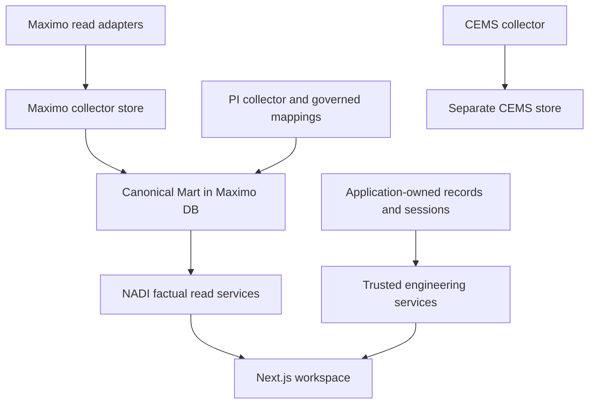

# NADI — Independent Architecture & Product Audit

**Task:** NADI-ASTRA-INDEPENDENT-AUDIT-01

**Review designation:** Astra High — independent principal-engineering audit

**Audit date:** 16 October 2026, Asia/Jakarta (15 October 2026 UTC)

**Repository:** `johnd-creator/reliability-knowledge-starter`

**Audited main:** `5af41294745d7eb78eb14f617cacdbc223844564`

**Disposition:** Documentation-only proposal. No recommendation is implementation authorization.

## 1. Executive Assessment

NADI has a credible architectural foundation for an evidence-driven reliability engineering workspace. Its strongest work is the separation of operational source reads from application-owned decisions, exact asset-scoped authority, independent review, and immutable evidence references. Those choices are more valuable than adding another dashboard. They should be preserved.

The main weakness is uneven maturity across that evidence chain. Human decision records have unusually careful transaction and authorization controls, while several upstream recovery and provenance mechanisms are materially weaker. A technically correct review of incomplete or ambiguously acquired evidence is still an unreliable engineering decision. In parallel, the current Action Board searches only the loaded page, and production access/deployment arrangements remain deliberately incomplete.

The three most important conclusions are:

1. **Prioritize recoverable ingestion and unambiguous acquisition provenance.** Generic Maximo synchronization can advance beyond a rejected row; local Mart projection can permanently miss a repaired reference; PI historical acquisition modes share an overwriting key. These are source-verifiable failure paths, not claims that operational data has already been lost.
2. **Complete one useful investigation-to-action workflow before expanding modules.** Native inspections, Cases, recommendations, follow-up, and advisory mechanisms already exist. Authorized population-wide queues and exact-version evidence navigation will deliver more value than additional portfolio visualizations or speculative predictive analytics.
3. **Keep development acceptance separate from permission to operate.** Main has passing selected CI evidence, but factual API authentication is not consistently enforced, full operational promotion is unfinished, and Phase 1 monitoring remains PARTIAL. PR #89 is an unmerged Administration proposal. Neither it nor the recent UI merges establishes production readiness.

There is no evidence here of an active security incident, an exposed production endpoint, or a need for a platform rewrite. **No CRITICAL finding and no P0 task are assigned.** HIGH findings describe consequential integrity paths or explicit future-release gates; urgency must be reassessed if an owner establishes that affected paths are currently exposed or operationally relied upon.

The recommended immediate work is five isolated, synthetic-testable slices: generic Maximo cursor safety, local Mart replay/checkpoint safety, PI historical acquisition lineage, component-aware CI coverage, and Action Board server-side filtering. These are proposals for subsequent authorization. This audit performs none of them.

## 2. Audit Scope & Evidence

### Baseline and method

The connected GitHub repository was the source of truth. Main was checked at the start of review and again during finalization; both matched the supplied SHA above. It includes the merge of PR #88. Source links in this report are pinned to that commit unless explicitly labeled as PR context. The recursive tree contained 1,315 entries and was not truncated.

A selected text snapshot of roughly 540 source, documentation, contract, and test files was retrieved. Retrieval is **not** an assertion that every line in those files was reviewed. Review concentrated on the implementation paths and tests listed below, with follow-up reading to validate or reject candidate findings. This is a targeted architecture/product audit, not exhaustive security verification or test coverage measurement.

| Evidence area | Material inspected and use |
|---|---|
| Product and governance | [Root README][readme], [PRD][prd], [roadmap][roadmap], [repository status][status], [UI specification][ui-spec], [Design System V1][design-system], applicable root/component instructions; compared historical intentions with current code and PR metadata. |
| Architecture and ownership | [Engineering Workspace ADR][adr6], [read-only source/application boundary ADR][adr7], [application store boundary][app-boundary], [Mart database facade][mart-db], migration/access controls, QA factory and runbook. ADRs were treated as design history where implementation had progressed. |
| Collector and Mart integrity | Generic Maximo sync and object configuration, specialized WO recency, local Mart projector and its tests, PI models/store/backfill/tests, CEMS collection and diagnostic probing/tests, integration reader and freshness contracts. |
| Human engineering workflows | Engineering Case services/repository/tests; reviewed human-record services/repository; inspection draft and evidence conversion; recommendation evidence validation; advisory and application evidence services; native PdM input and engineer-validation documentation. |
| Identity and session security | SessionAuthority, trusted identity adapter, LocalIdentityProvider, application session routes, private administrative boundaries, access/migration tests, HTTP and QA acceptance source. |
| UI and APIs | FastAPI factory/factual router/human-record router, Next rewrites and QA proxy, shared UI/navigation, recommendation workspace, inspection/PdM entrypoints, integration/report pages and browser fixtures, error/loading/empty-state patterns. |
| Build and operational preparation | The single candidate workflow, package/build scripts, selected PostgreSQL/HTTP/browser tests, release binding, preflight and backup/restore rehearsal source, development/runtime investigation documents. |
| External repository state | Current branch metadata, repository rulesets, PR metadata/diffs/context, and exact-main workflow run/job outcomes. These are time-of-audit observations, not immutable policy attestations. |

### PR interpretation

| PR | Observed state | How it was used |
|---|---|---|
| [#88](https://github.com/johnd-creator/reliability-knowledge-starter/pull/88) | MERGED | Reports Center development checkpoint; implementation reviewed on main. |
| [#87](https://github.com/johnd-creator/reliability-knowledge-starter/pull/87) | MERGED | System Integration Center development checkpoint. |
| [#86](https://github.com/johnd-creator/reliability-knowledge-starter/pull/86) | MERGED | Engineer-validation packet; pending definitions remain pending. |
| [#85](https://github.com/johnd-creator/reliability-knowledge-starter/pull/85), [#82](https://github.com/johnd-creator/reliability-knowledge-starter/pull/82) | MERGED | Workbook candidates and native PdM input, respectively; not field approval. |
| [#83](https://github.com/johnd-creator/reliability-knowledge-starter/pull/83) | MERGED | Local development tooling; not operational deployment acceptance. |
| [#74](https://github.com/johnd-creator/reliability-knowledge-starter/pull/74) | MERGED | Historical 72-hour monitoring review, explicitly PARTIAL. |
| [#89](https://github.com/johnd-creator/reliability-knowledge-starter/pull/89) | OPEN, DRAFT; head `050b4a73b468bb0acaa6de2f8a6aa8adecce28fd` | Unmerged Administration architecture/context only. Its capability inventory, authorization matrix, seven prerequisites, twelve pending decisions and proposed ADMIN slices are not main functionality. This backlog does not recreate them. |
| [#75](https://github.com/johnd-creator/reliability-knowledge-starter/pull/75)–[#81](https://github.com/johnd-creator/reliability-knowledge-starter/pull/81) | OPEN; #77–#81 DRAFT, #75–#76 non-draft | Frozen historical investigations. Metadata and relevant investigation context were reviewed, not adopted. Their stacked branch behavior does not prove a defect on audited main. |

Current GitHub merge/draft metadata takes precedence over stale “draft/unmerged” prose retained inside historical handoff documents. Conversely, a merge does not upgrade a document's explicitly limited operational evidence.

### What was actually tested

No application tests, collectors, services, migrations, browser sessions, penetration tests, or operational queries were executed by this audit. Existing test **source** was inspected. GitHub reports [workflow run 38768396811](https://github.com/johnd-creator/reliability-knowledge-starter/actions/runs/38768396811), dispatched against the exact audited main SHA, completed successfully; backend job `116537524323` and frontend job `116537524838` were successful. That verifies the recorded execution of the workflow's selected checks, not every repository test or an operational installation.

Only the audit document's structure, source-link targets and delivery diff are checked as part of this assignment. Proposed regression tests below are **future acceptance criteria**, not results obtained here.

### Coverage limitations

- No office network, active development laptop, source systems, collectors, Mart, real application database, identities, sessions, credentials or deployment settings were accessed.
- Workbook inventory and field mappings were examined through source-controlled contracts and validation documents. The seven binary workbooks and 200 sheets were not independently reopened or visually verified. “48 DIRECT + 3 AMBIGUOUS” is the documented candidate inventory, not this audit's independent engineering validation.
- UI behavior was assessed from components, contracts and existing test evidence. No new visual, mobile, assistive-technology or user usability session was conducted.
- Source inspection cannot establish actual installed dependency versions, current endpoint exposure, current operational row counts, data loss incidence, retention compliance, restore duration or production performance.
- Historical runtime investigations remain hypotheses about their recorded environments. No memory leak, restart requirement, or root cause of `ERR_TOO_MANY_RETRIES` is asserted for main.

**Confidence:** VERIFIED means the mechanism or state is directly present in inspected source/metadata. STRONGLY_SUPPORTED means the consequence follows from multiple observations but needs a focused test. HYPOTHESIS means the evidence is insufficient and a verification task is necessary. VERIFIED source behavior does not imply a reproduced incident.

**Effort:** S = a small localized change; M = one bounded component slice; L = a cross-layer change or compatibility/migration design; XL = a program spanning multiple approvals or deployments. These are relative implementation sizes, not calendar promises.

## 3. Current Architecture Assessment

### Ownership and dependency direction

This is an ownership/dependency diagram, not a deployment topology. The PI-to-Mart edge denotes the governed evidence bridge, not wholesale ingestion of the historian into NADI. CEMS is not connected to a current NADI decision/status contract. The legacy Cockpit database/KPI path also remains; it must not be mistaken for the canonical Mart.

The canonical Mart is owned by the Maximo-side data platform and shares that database boundary. NADI reads it through a separate, explicit Mart configuration and read-only facade. The application store owns human-authored Cases, inspections, recommendations, review history, attachments metadata and identity/session state. Reusing an existing application database with a distinct namespace and privilege boundary is appropriate; another database is not inherently required. The QA factory's isolated test database is not an operational topology decision.

The business Reliability Asset Registry is not synonymous with the full technical `asset_master` inventory. Registry membership expresses the governed reliability population; technical asset rows provide identity/context. Aggregates correctly use that population in important paths. A wider technical inventory does not justify a wider reliability denominator.

The architecture supports a modular monolith plus source-specific collectors. It does not currently justify microservices, a message bus, a new analytical warehouse, or generalized event sourcing. Existing transactional revision history is sufficient for the present human workflows. Introduce infrastructure only after measured workload or isolation requirements demand it.

### Maturity by boundary

| Boundary | Assessment | Principal constraint |
|---|---|---|
| Operational source → local acquisition | Useful source-specific safeguards; uneven recovery maturity | Generic cursor behavior, CEMS diagnostic promotion, PI sampling lineage. |
| Local acquisition → canonical Mart | Clear ownership and bounded scope | Deferred-reference replay and checkpoint completeness are incomplete. |
| Mart → factual API | Explicit read-only data access | Consistent authenticated, asset-scoped reader policy is not wired. |
| Human record → reviewed decision | Strong candidate domain and transaction controls | Operational hosting, approved PdM definitions and evidence-context transfer remain gated. |
| Services → workspace | Reusable V1 design and honest data limitations | Page-local workflow queues and fragmented context impede daily work. |
| Repository → operational release | Substantial synthetic QA preparation | Selected CI is narrower than repository risk; merge enforcement and real target acceptance remain unproven/incomplete. |

API versioning is strongest where immutable evidence/revision contracts are explicit. Factual aggregate responses and cross-module navigation need similarly explicit scope, definition and completeness metadata before becoming stable external/reporting contracts. Error handling generally isolates unavailable evidence rather than inventing data, but it cannot substitute for recovery ledgers. The fixed site/source assumptions are acceptable for a bounded single-site candidate and become a deliberate architecture gate for expansion.

## 4. What NADI Already Does Well

1. **It protects ownership boundaries in code.** [MartDatabase][mart-db] has no silent legacy-DSN fallback, rejects mutations through the read facade, applies PostgreSQL read-only transaction behavior and a statement timeout. [ApplicationStore][app-boundary] checks expected database identity and rejects Mart anchors. Preserve both application enforcement and database privileges.
2. **Human decisions are transactional and revisioned.** [Case persistence][case-repo] and [human-record persistence][human-repo] combine record updates, immutable revision history and idempotency receipts with compare-and-swap revision checks. Retries are checked against request fingerprints; asset identity is not casually mutable.
3. **Review independence is more than a UI role check.** [CaseService][case-service] and reviewed-record services enforce exact canonical asset scope and exclude creators, assignees and prior contributors from independent review. Reassignment does not erase contributor history. ADMIN does not automatically become AUTHOR. These rules should remain central service invariants.
4. **Recommendation approval follows evidence state.** Recommendation services recheck approved same-asset Case evidence and support independent completion verification. An existing work-order reference is informational; NADI does not acquire Maximo execution authority.
5. **Sessions and local credentials have substantial safeguards.** [SessionAuthority][identity] hashes session tokens, uses secure HttpOnly strict cookies, checks exact HTTPS Origin and session-bound CSRF for protected mutations, revalidates grants and supports revocation with bounded concurrency/cleanup. [LocalIdentityProvider][local-auth] uses Argon2id, bounded password work, generic denial behavior, forced password change and guarded identity mutation. These are candidate controls, not evidence that every public route consumes them.
6. **Migration and privilege design is thoughtful.** [Application migrations][migrations] use checksums, a migration ledger and PostgreSQL advisory locking. [Access verification][access] separates owner/capability/runtime roles and checks append-only history permissions. Runtime-only audit immutability is valuable, while database-owner tampering remains an operational custody concern.
7. **Engineering uncertainty is often represented honestly.** Frozen, strict evidence models reject extra fields, non-finite values and naive datetimes. Unknown quality, units, mappings and readiness do not automatically become healthy/zero. Fresh collector activity is distinguished from source-value and projection freshness in the governed concepts.
8. **The UI foundation is worth keeping.** Shared tokens/components, keyboard focus management, a skip link, drawer focus handling, contained wide tables, chart table alternatives, light/dark support and independent error states reduce avoidable inconsistency. Reports guard against late response overwrite. Further usefulness should come from workflow improvements, not a replacement visual system.
9. **Recovery and deployment work is not absent.** Specialized [WO recency][wo-recency] has stronger completeness/recovery protections than generic synchronization. Isolated PostgreSQL, HTTP, browser fixtures, release/preflight checks and [backup/restore rehearsal tests][rehearsal] already exist. Improve their scope and promotion evidence instead of rebuilding them.

## 5. Critical Findings

“Critical Findings” is the requested section title; none of the findings below is rated CRITICAL. IDs are stable references, not a numerical risk score. The following order groups the most consequential integrity and activation concerns before product/maintenance limitations.

### F-02 — Generic Maximo sync can advance past a failed row

**Category:** Data integrity/recovery · **Severity:** HIGH · **Confidence:** VERIFIED · **Effort:** M

**Evidence:** [SyncConfig and synchronization loop][sync], especially `cursor_requires_zero_errors=False` at line 46, raw `last_change` updates at lines 173–176, error handling and cursor persistence at lines 258–266; [object configuration][maximo-api], `OBJECTS`/`sync_config_for`. Routine asset/SR/person/item paths do not all opt into strict cursor behavior. Specialized WO and asset-baseline protections must be distinguished from this default. `tests/test_sync.py::test_bad_row_skipped_not_fatal` checks skip/error behavior; the strict baseline test addresses a different configuration.

**Observed behavior and consequence:** The raw timestamp contributes to the high watermark before mapping/persistence succeeds. A completed traversal can persist that watermark despite a skipped row. For a failed row at T1 and a later valid row at T2, a subsequent incremental query beginning at T2 does not revisit the corrected T1 row unless its source timestamp changes or recovery is explicitly initiated. Inclusive timestamp comparison does not recover an older failure. This is a code-level omission path; actual operational omissions were not measured.

**Correction:** Refuse progress beyond unresolved failures or maintain a durable replay obligation that survives advancement. Merely taking the maximum successfully written timestamp still skips an older failed row. Preserve idempotent upserts, tied-timestamp behavior and specialized WO recovery.

**Dependencies/actionability:** Offline code and synthetic fixtures need neither engineer approval nor office access. Source replay, cursor reset or live collector rollout requires operator authorization. Proposed task **AUD-01**.

### F-03 — Local Mart checkpoints do not guarantee recoverable coverage

**Category:** Data projection/completeness · **Severity:** HIGH · **Confidence:** VERIFIED for deferred-row loss path; STRONGLY_SUPPORTED for concurrent traversal risk · **Effort:** L

**Evidence:** [LocalMartProjector][projector], `_save_state` lines 189–208 and `project` lines 220–291. Pages use offset ordering in separate sessions; missing equipment and mapping failures are skipped; the final watermark is the whole local table's maximum source-change time; saved status is `SUCCEEDED`. Incremental recovery uses a bounded overlap. [IntegrationMartReader][integration-reader] exposes last-state information rather than a durable per-run reconciliation of omitted rows.

**Observed behavior and consequence:** An old WO skipped for a missing equipment reference can fall outside the overlap after a newer checkpoint. Adding its equipment later does not change the WO timestamp, so ordinary incremental projection need not retry it. Independently, a local row changed after its page was passed but before the final maximum is read can influence the checkpoint without being projected; this interleaving needs a deterministic regression test. Intentional scope exclusion is legitimate, but is not equivalent to unresolved mapping failure.

**Correction:** Define a bounded input snapshot/fence, traverse stably, and checkpoint only the covered population. Persist deferred-reference/mapping dispositions and replay them when dependencies change. Record successful coverage, expected exclusions and unresolved failures separately. A recent completed run must not imply complete evidence.

**Dependencies/actionability:** Candidate implementation and synthetic tests are office-independent. Any new ledger/migration, live replay or runtime promotion needs the data owner/operator. No source recollection or global rewind is authorized. **AUD-02**.

### F-04 — PI historical rows lose acquisition-mode identity

**Category:** Time-series provenance · **Severity:** HIGH · **Confidence:** VERIFIED · **Effort:** L

**Evidence:** [TimeseriesOrm][pi-models] lines 47–65 keys rows by `(attribute_id, timestamp)` without acquisition mode or interpolation interval. [bulk_insert_timeseries][pi-store] lines 242–297 deduplicates and upserts on that pair. [CollectorService backfill methods][pi-collector] send both interpolated and recorded results to this store. Backfill progress distinguishes interval/`recorded`, but stored points do not. Existing interval-watermark tests therefore do not protect data identity.

**Observed behavior and consequence:** Recorded and interpolated samples sharing a timestamp overwrite one another. Samples at different timestamps can coexist without a way to identify which acquisition semantics produced them. Quality flags and units are retained, which is good, but cannot reconstruct acquisition mode. This undermines reproducibility and future trend validation. It does not prove that every colliding value differs or that the current governed NADI snapshot bridge uses these historical rows.

**Correction:** Design an acquisition identity containing source/attribute identity, recorded-versus-interpolated mode, interval where relevant and retrieval/configuration provenance; preserve distinct sample streams and define deterministic replay within each. Legacy rows must remain provenance-UNKNOWN unless supported by external evidence; cadence is not proof. Define bounded query completeness and continuation behavior alongside the new reader contract.

**Dependencies/actionability:** A backward-compatible candidate model/migration and synthetic tests can start offline. Applying DDL, reimporting historian data or declaring historical comparability needs operator/engineer approval. **AUD-03**.

### F-01 — Factual API reads lack the trusted authorization boundary used by human workflows

**Category:** Security/activation · **Severity:** HIGH · **Confidence:** VERIFIED mechanism; deployment exposure not established · **Effort:** L

**Evidence:** [create_app][app], [factual reliability endpoints][reliability-api] (`_service`/database dependencies and routes around lines 660–674 and 926–1136), and [Next rewrite configuration][next-config]. Factual readers do not depend on the trusted actor/asset-scope checks used by engineering services. `/api/cockpit/:path*` has a general rewrite. Development-only guards on Reports/Integration page mounting do not protect direct API requests or that rewrite.

**Observed behavior and consequence:** A caller who can reach these routes can invoke factual reads without the application's trusted identity dependency. Fixed site/org predicates are data boundaries, not caller authorization. The current deliberate development arrangement is not itself evidence of a public data breach. It is an explicit blocker to exposing confidential factual data in a shared installation.

**Correction:** Approve a factual-reader policy, then apply existing trusted identity and exact scope semantics consistently to direct and proxied reads, including lists, aggregates, counts and error responses. Restrict before aggregation/pagination. Verify unauthenticated, revoked and out-of-scope behavior at both entrypoints. Do not assume a hidden navigation item or `NODE_ENV` provides access control.

**Dependencies/actionability:** Policy and production activation require PO/security decisions. Isolated contract implementation follows those decisions; no global authentication change is authorized here. Coordinate with PR #89, but do not duplicate its account/grant/admin mutation work. **AUD-06**.

### F-05 — CEMS plausibility probing can promote an alternate interpretation into collected data

**Category:** Instrument-data semantics · **Severity:** HIGH · **Confidence:** VERIFIED behavior; incorrect plant decoding not demonstrated · **Effort:** M

**Evidence:** [CEMS collection][cems-collect], `_read_parameter`, `should_probe_after_success`, `_probe_or_keep`, normalization and remembered overrides; [diagnostic probing][cems-diagnostics] lines 106–155; `tests/test_collect.py::test_implausible_so2_triggers_probe_and_learns`. The diagnostic searches register/address/word-order alternatives and returns a plausible candidate. This is deliberate existing behavior, not a newly inferred unauthorized source operation.

**Observed behavior and consequence:** Plausibility may select the value subsequently normalized and persisted, while the selected override is remembered in process. A numerically plausible alternative is not proof of the physical register's meaning. Selected raw context does not, by itself, preserve the original reading as a separate observation with a reviewed configuration decision. Restart behavior can also differ when learned overrides are not durable.

**Correction:** Preserve original acquisition evidence and quarantine diagnostic alternatives separately. Promote a register/type/order configuration only through explicit, versioned instrument-owner review. Keep already approved normalizations intact until reviewed; do not invent new thresholds or adjust formulas during a software cleanup.

**Dependencies/actionability:** Offline diagnostic tests and a proposed provenance contract are possible now. Changing live selection behavior, register configuration or engineering interpretation requires instrument/operations approval and source-safe validation. CEMS remains outside the current NADI decision model. **AUD-07**.

### F-06 — Passing candidate CI covers a narrower risk surface than the repository

**Category:** Verification/CI · **Severity:** HIGH · **Confidence:** VERIFIED · **Effort:** M

**Evidence:** [Candidate workflow][ci] has pull-request path filters for Cockpit/contracts/development tooling, not collector-only changes. Its backend command enumerates selected tests and omits collector suites and the engineering repository suite. [EngineeringPostgresTest][engineering-tests] at lines 346–402 requires `NADI_ENGINEERING_TEST_DSN`; the workflow supplies `NADI_APPLICATION_TEST_DSN` and does not select this module. Other PostgreSQL suites do run; this is not “no database testing.” [Browser build harness][browser-build] aliases Next modules and uses bundled framework internals.

**Observed behavior and consequence:** Collector regressions can miss this workflow entirely. Existing Case concurrency/audit tests are not part of the observed main run. Browser fixtures are useful for component behavior and accessibility but do not establish a real Next-to-backend request path. The successful run is valid evidence for its selected checks only.

**Correction:** Use affected-component matrices with explicit required suites and disposable database names/roles. Report expected test execution and skips. Add a small isolated real Next/API integration lane for proxy/session contracts without discarding fast fixture tests. Keep heavy browser work path-selective to control cost.

**Dependencies/actionability:** Code/CI changes can be designed and tested without plant access; CI resource/settings approval may be needed for adoption. No production credentials belong in these jobs. **AUD-04**.

### F-12 — Operational promotion remains an unfinished boundary, not a build flag

**Category:** Deployment/recovery readiness · **Severity:** HIGH · **Confidence:** VERIFIED repository gap; target environment unknown · **Effort:** L

**Evidence:** [QA factory][qa-factory] is deliberately development/test constrained; ordinary [create_app][app] is not a production engineering application assembly. [QA advisory schema helper][qa-advisory] extends test-only schema, while ordinary [human-record migration 004][human-migration] starts with inspection/recommendation kinds. [QA runbook][qa-runbook], [release binding][release] and [restore rehearsal source][rehearsal] define important candidate preparation.

**Observed behavior and consequence:** Removing QA guards or setting production environment variables would not establish an approved production assembly, complete promoted schema, least-privilege identities, attachment custody/scanning, trusted proxy/TLS, backup ownership or accepted rollback. Source-hash binding is useful provenance, not a signed full deployment attestation. Existing disposable PostgreSQL dump/restore and blob checks must be credited; they do not establish actual target RPO/RTO or operator recovery competence.

**Correction:** Produce a separate explicit production adapter/assembly and reviewed additive schema path only after target decisions. Reuse the existing preflight/release machinery and execute a target-specific restore/rollback rehearsal under operator authority. Bind backend, frontend, configuration and deployment artifact identity.

**Dependencies/actionability:** Planning and isolated candidates are possible remotely; real promotion requires operations/security/data-custodian approval. PR #89 remains the owner of Administration-specific prerequisites. **AUD-10**.

### F-07 — Observed repository settings do not enforce the review discipline used in documentation

**Category:** Change governance · **Severity:** HIGH · **Confidence:** VERIFIED point-in-time metadata · **Effort:** S

**Evidence:** Connected GitHub reads of [main branch metadata](https://api.github.com/repos/johnd-creator/reliability-knowledge-starter/branches/main) returned `protected=false` and required checks off; the repository [rulesets collection](https://api.github.com/repos/johnd-creator/reliability-knowledge-starter/rulesets) returned an empty list. These observations do not attest to unexposed organization-level controls or who can push.

**Observed behavior and consequence:** Review/no-auto-merge practices are documented but not enforced by the observed branch/ruleset settings. As contributors and automated work increase, accidental direct updates or merges without relevant checks become easier. No unauthorized merge is alleged.

**Correction:** After a repository-owner decision, enforce appropriate review, a stable required-check result and protected main updates. Design the aggregate check to handle legitimate path-skipped jobs without deadlocks. Preserve a documented, auditable emergency path rather than making routine bypass normal.

**Dependencies/actionability:** Requires owner/settings authority; not an office-network task and not an approved policy mutation under this audit. Depends on a coherent CI check contract from AUD-04. **AUD-08**.

### F-08 — Action Board filters and attention counts cover only the current page

**Category:** Product workflow/API consistency · **Severity:** MEDIUM · **Confidence:** VERIFIED · **Effort:** M

**Evidence:** [RecommendationWorkspace][recommendation-ui] lines 16–20 filters the fetched page and computes queues/counts from those rows; UI copy explicitly says only 25 server-authorized records are searched. [Human-record listing route][human-api] lines 43–58 passes filters for inspections but invokes the generic recommendation listing with only offset/limit, ignoring the exposed `asset_id` parameter for that branch.

**Observed behavior and consequence:** The labels are honest; this is not a false global count. However, an engineer looking for an awaiting-review item on a later page cannot find it through the current page's search/filter, and the board cannot serve as a dependable population-wide work queue. Query parameters that are accepted but ignored also weaken API predictability.

**Correction:** Apply authorized server-side filtering and matching counts before pagination, with stable ordering and explicit scope metadata. Preserve selected context in the URL and return navigation. Do not turn local dates/missing owners into inferred operational urgency or a risk score.

**Dependencies/actionability:** Synthetic QA implementation needs no engineer or office access. PO can later decide defaults without blocking correct filtering. Authentication/scoping invariants remain mandatory. **AUD-05**.

### F-09 — Reviewed inspection handoff omits interpretation context from the Case evidence envelope

**Category:** Engineering evidence semantics · **Severity:** MEDIUM · **Confidence:** VERIFIED · **Effort:** L

**Evidence:** [InspectionDraft][inspection-domain] contains `operating_context` and `method_extension`. [ReviewedInspectionCatalog.resolve][inspection-evidence] resolves and hashes an exact reviewed revision, but [ReviewedInspectionEvidence][reviewed-domain] transfers only a subset and excludes those fields. [Engineer-validation packet][engineer-packet] already identifies the limitation.

**Observed behavior and consequence:** The full source revision is retained and its hash is meaningful; there is no claim of undetected mutation. The frozen Case envelope alone nevertheless lacks context that may be necessary to interpret a vibration, infrared, oil or MCSA measurement. A reviewer may have to navigate separately to the exact source revision, and cannot assume two measurements are comparable because their displayed values share a label.

**Correction:** After engineering decisions, version the evidence envelope with approved context/point/definition/time references and offer authorized navigation to the exact source revision. Never silently enrich old frozen snapshots from a mutable current record. Unapproved fields must not acquire authoritative physical meaning through copying.

**Dependencies/actionability:** Bound to the 26 pending decisions and M02 readiness. Engineering approval is required for semantic changes; office-independent source-revision navigation can be scoped separately without approving measurements. M02/M03/M07 remain ON HOLD. **AUD-09**, with navigation opportunity in AUD-14.

### F-10 — Historical freshness evidence cannot fully reproduce monitoring or policy validity

**Category:** Observability/governance · **Severity:** MEDIUM · **Confidence:** VERIFIED limitation · **Effort:** L

**Evidence:** [72-hour review][monitoring-review] explicitly states PARTIAL/UNKNOWN, lacks exact per-domain Mart commit history and full gate/alert event history, and notes latest-only snapshot limitations. It records a manual hard expiry of **13 October 2026, 00:00 Asia/Jakarta**. [FreshnessPolicy][freshness] represents numerical freshness settings but not a complete approval/version/expiry attestation.

**Observed behavior and consequence:** Current activity timestamps cannot retrospectively prove continuous policy compliance, false-alert rate or complete readiness at a past cutoff. The documented expiry precedes this audit, but no post-expiry operational attestation was inspected: neither continued operation nor completed shutdown/renewal is asserted. Fresh activity is not authorization to keep a temporary policy active.

**Correction:** Persist bounded run attempts/outcomes and governed policy provenance/validity separately from data freshness. Retain the minimum evidence required to replay gate decisions and adjudicate alerts. Display unknown/expired/unverified policy state independently from source activity; thresholds and renewal authority remain unchanged until approved.

**Dependencies/actionability:** Offline ledger/read-contract design is possible. Policy interpretation, renewal/expiry actions, retention and live monitoring require owner/operator approval. **AUD-11**.

### F-11 — The weekly report trend can include records after its own as-of time

**Category:** Aggregate correctness · **Severity:** MEDIUM · **Confidence:** VERIFIED code path; no operational future-row incidence established · **Effort:** S

**Evidence:** [MartReader.decision_overview][mart-reader] lines 1119–1127 bounds weekly buckets by week start/end but omits `scoped_date <= current`. Its 7/30/90-day summaries and window distributions at lines 1131 onward include that cutoff.

**Observed behavior and consequence:** A future-dated event within the current calendar week can appear in the weekly trend while being excluded from the as-of summaries. The intentional 12-week trend versus selectable 7/30/90-day window is not the defect; nor is showing a calendar bucket whose end lies in the future. The issue is counting future observations inside it.

**Correction:** Apply the response's as-of cutoff to included trend observations, retaining existing bucket definitions and explicit date semantics. Test future rows, exact-cutoff inclusion and week/timezone boundaries. Source-change time remains a disclosed fallback, not equipment failure time.

**Dependencies/actionability:** No engineering or office approval needed for a synthetic correctness fix. Do not redefine reliability metrics. **AUD-12**.

### F-13 — Site and source assumptions are distributed across the candidate

**Category:** Extensibility/isolation · **Severity:** MEDIUM · **Confidence:** VERIFIED constraint · **Effort:** L for design; XL for multi-plant rollout

**Evidence:** [MartReader][mart-reader] and [IntegrationMartReader][integration-reader] apply fixed site/org values; Maximo synchronization scope is bounded to the approved site; condition evidence lineage includes a fixed PI source identity in [condition evidence contracts][freshness]. Canonical identifiers already retain source/site/org dimensions, which is worth preserving.

**Observed behavior and consequence:** This is intentional and acceptable for the current single-site boundary. A future expansion implemented by scattered constant replacement could mix populations or reuse grants/mappings under the wrong source identity. Multi-unit within one identity authority and multi-plant with distinct authorities are different deployment problems.

**Correction:** After a concrete second-site requirement, introduce an explicit deployment/source context at composition boundaries, while retaining canonical identity and source-approved adapter constraints. Decide identity realm and isolation boundaries first. Do not make all queries globally configurable as a shortcut.

**Dependencies/actionability:** Architecture exploration can occur remotely; actual new-source semantics and multi-plant authority need PO, security and source-owner approval. Not an immediate task. **AUD-15**.

### F-14 — Some authorized reads scale with the entire matching population

**Category:** Performance/query design · **Severity:** MEDIUM · **Confidence:** STRONGLY_SUPPORTED risk; production SLO breach is HYPOTHESIS · **Effort:** M investigation, L only if redesign is justified

**Evidence:** [InspectionService][inspection-service], `_read_events`, filters authorized records but iterates matching documents and measurements to validate/count results; `yield_per` bounds fetch buffers, not total work. [IntegrationMartReader.inventory][integration-reader] materializes registry/mapping/evidence sets. JSON record storage is reasonable at current scale but is not automatically an efficient indexed work queue.

**Observed behavior and consequence:** Work per request can grow with the authorized population even for one result page. There is no measured production latency, memory or concurrency failure in this audit. A statement timeout does not cap total Python processing or a sequence of queries, and long authenticated requests may prolong guard/lease occupancy.

**Correction:** First benchmark representative synthetic populations and concurrent reads with query counts, elapsed time and memory. Only then add indexed read projections or SQL-side filters/counts in the same owning store. Keep full authorization and exact revision semantics; do not add a search cluster speculatively.

**Dependencies/actionability:** Office-independent investigation is executable; performance budgets/retention need PO input and operational index/migration rollout needs approval. **AUD-13** is the verification task, not a presumption of failure.

### F-15 — Build reproducibility and framework coupling are uneven

**Category:** Maintainability/dependency control · **Severity:** MEDIUM · **Confidence:** VERIFIED mechanism · **Effort:** M

**Evidence:** [Cockpit dependency manifest][python-deps] uses broad dependency ranges and the inspected tree has no Python lock/constraints counterpart to the frontend lockfile. [API factory][app] extends `app.router.routes` directly for a compatibility workaround. [Browser fixture build][browser-build] uses `next/dist/compiled/webpack` and aliases framework modules. The workflow installs Python dependencies from the current resolver outcome.

**Observed behavior and consequence:** The same source can resolve different Python dependencies over time; internal framework interfaces and fixture substitutes may change independently of intended contracts. This increases the cost of interpreting runtime investigations and distinguishing test-harness behavior from real integration. No vulnerable package version or CVE is asserted.

**Correction:** Record and reproducibly resolve supported dependency sets, with deliberate upgrade checks. Replace internal route-registration behavior through a focused compatibility slice once the supported framework range is decided. Keep fixture harnesses but pair them with real routing/proxy tests. Do not cherry-pick frozen investigation patches as a dependency strategy.

**Dependencies/actionability:** Offline implementation is possible; version policy and CI cost are maintainer decisions. Operational upgrades remain separately authorized. **AUD-16**.

## 6. Technical Debt Register

| Debt | Root cause and impact | Disposition | Finding/task |
|---|---|---|---|
| Cursor success differs from recoverable coverage | Generic skip tolerance and progress tracking are coupled; omissions can outlive a run | Fix recovery invariant before scaling collection | F-02 / AUD-01 |
| Projection success lacks reconciled omissions | Latest-state checkpoint and bounded overlap stand in for a durable replay model | Add bounded coverage and explicit deferred dispositions | F-03 / AUD-02 |
| Historical PI sample identity is underspecified | Acquisition intent exists in progress tracking but not the actual series key | Version compatible storage/read contract; preserve unknown legacy provenance | F-04 / AUD-03 |
| Reader authorization differs by module | Candidate factual readers and trusted human workflows evolved separately | Approved read-policy adapter, not a second identity service | F-01 / AUD-06 |
| Diagnostic evidence and accepted CEMS value share a path | Recovery convenience can conceal interpretation choice | Separate observation, diagnostic hypothesis and reviewed configuration | F-05 / AUD-07 |
| Selective CI resembles a repository-wide gate | Accumulated explicit commands and narrow triggers | Affected-component matrix and clear check contract | F-06 / AUD-04 |
| Manual merge discipline | Settings do not enforce documented review expectations | Owner-approved protection after check design | F-07 / AUD-08 |
| Page-scoped work management | Reused register UI was promoted into a board without server query capability | Population-wide authorized queue contract | F-08 / AUD-05 |
| Inspection context is not a versioned handoff contract | Minimal initial evidence schema predates pending engineering definitions | Preserve old snapshots; approve a new envelope | F-09 / AUD-09 |
| Latest-state monitoring cannot reconstruct history | Monitoring records evolved by component; policy provenance is separate/manual | Minimal common run/policy evidence vocabulary, no new monitoring platform | F-10 / AUD-11 |
| Inconsistent as-of predicates | Independently assembled report aggregates | Localized cutoff regression fix | F-11 / AUD-12 |
| QA promotion requires manual interpretation | Test-only assembly/schema helpers are not an operational release | Explicit production composition and accepted target rehearsal | F-12 / AUD-10 |
| Fixed site context is scattered | Deliberately bounded pilot | Retain now; centralize only for a real second deployment | F-13 / AUD-15 |
| Full-population work behind paginated readers | JSON validation and exact counts favor simplicity | Benchmark first; add selective read projections if needed | F-14 / AUD-13 |
| Dependency/internal-framework coupling | Fast-moving candidate compatibility work | Reproducible environment and supported integration tests | F-15 / AUD-16 |

There is also documentation navigation debt: historical acceptance notes, current-state summaries and appended roadmap entries coexist. Preserve immutable historical evidence, but make the current implementation/approval matrix authoritative and link to superseded checkpoints. This is a low-priority maintenance recommendation, not an additional confirmed security finding or a reason to rewrite the official roadmap in this audit.

## 7. Missing Product Capabilities

These opportunities extend existing modules. They are not approved requirements or implicit implementation assignments.

| Opportunity | Current limitation → proposed capability | Users and data | Validation prerequisites | Complexity / execution lane |
|---|---|---|---|---|
| O-01: A dependable personal/team attention queue | Page-local Action Board → authorized global filters for review, owner/date gaps and completion verification, with counts matching the filtered population | Authors, reviewers, reliability coordinators; existing recommendation/revision/assignment data | Beyond-first-page fixtures, denied-scope non-disclosure, stable pagination; PO chooses defaults, not engineering urgency | M; immediate candidate via AUD-05 |
| O-02: Exact-version evidence navigation | Context is distributed across asset, inspection, Case and recommendation views → linked evidence trail with source revision, collection/measurement time, unit/quality and visible limitations | Investigating engineers and reviewers; existing canonical IDs, immutable revisions, evidence refs | Authorization on every link; changed/retracted evidence remains visible as history; engineering approval before adding semantic context fields | M/L; navigation can start offline after PO workflow choice, semantic extension blocked; AUD-14/AUD-09 |
| O-03: Data-quality remediation worklist | Skipped mappings and unresolved references are operational counters rather than actionable obligations → owner/reason/retry/disposition queue tied to immutable acquisition evidence | Data stewards, collector operators; replay ledger from AUD-01/02 | Approved ownership and retention; distinguish expected exclusion from unresolved input; never auto-verify an asset/AF match | L; PO + operator decisions; builds on recovery tasks |
| O-04: A reproducible decision-review packet | Current report previews show useful bounded facts without a durable cross-section snapshot manifest → approved factual packet with scope, as-of, definition version, completeness and evidence references | Reliability managers and review meetings; authorized Mart aggregates plus application decisions | Approved metric definitions, consistent snapshot semantics, export/custody policy; unknown is not zero | L; PO + security/custody; AUD-17 |
| O-05: Outcome learning from completed recommendations | Workflow can record follow-up/verification, but product value is not demonstrated merely by creating records → intended outcome, verification evidence and review disposition linked end-to-end | Reliability managers and responsible engineers; existing recommendation/follow-up/evidence data | PO defines administrative cycle-time measures; engineer validates physical effectiveness claims; no causal savings or failure-rate inference from sparse records | M/L; PO first, engineering for outcome interpretation |
| O-06: A governed measurement-definition library | Native forms and workbook candidates precede approved point/unit/context definitions → small versioned method profiles and physical-point binding for one approved cohort | PdM engineers across vibration, infrared, tribology and MCSA; approved field definitions/point registry/operating conditions | Resolve relevant pending decisions; version/time semantics and comparability rules; explicitly retained non-comparable history | L; engineer-blocked M02 track, not immediate |
| O-07: Acquisition coverage diagnostics | “Latest activity” cannot explain which approved population was actually covered → coverage by source scope, mode, interval, failure/replay state and policy validity | Collector operators and data stewards; run ledgers and source registry | Operational retention and policy decisions; no inference that fresh data is reliable equipment | M/L; offline contract first, operational activation blocked |
| O-08: A coherent investigation workspace | Repeated IDs, caveats and module changes increase cognitive load → persistent selected-asset/case context, reversible navigation, expandable evidence details and one clear next permitted action | Engineers using current V1 screens; existing authorized metadata | Task-based usability checks, keyboard/reader support, no hidden safety limits; retain primary UNKNOWN/error states | M; PO selects representative workflow; AUD-14 |

NADI's differentiator should be the defensible chain from observation to reviewed decision to verified follow-up. Maximo already owns work execution; PI owns historical process acquisition; CEMS has instrument/regulatory responsibilities. Duplicating these systems' full interfaces would increase cost without solving NADI's distinctive problem.

Potential intelligent assistance should initially be deterministic: find related approved evidence, detect missing required context and show changed supporting revisions. Any later learned model requires approved measurement identity, stable labels, sufficient operating exposure and failure outcomes, equipment/time-separated evaluation, leakage controls and prospective human review. The current evidence does not support predicting failures or assigning health scores.

## 8. Security & Deployment Readiness

### Control assessment

| Surface | Existing control/evidence | Remaining boundary |
|---|---|---|
| Human workflow authority | Trusted actor, exact asset scopes, independent review, fresh grant checks | Preserve across new filters, evidence links and production assembly; ADMIN is not universal author/reviewer. |
| Sessions/CSRF | Secure cookie, token hashing, strict origin/CSRF, revocation, bounded work | Correct TLS/proxy/origin deployment and all-route consumption must be demonstrated on the approved target. |
| Local accounts | Argon2id and guarded private management primitives | No public Administration Center is implemented by merging unrelated UI work; PR #89's decisions remain separate. |
| Factual reads | Read-only Mart access and bounded data scope | Read-only prevents mutation, not disclosure; F-01 must be resolved before shared exposure. |
| Database mutation | Application-only namespace, revision/CAS/idempotency, migration checksums, access verification | Operational roles/grants and promoted schema must be independently accepted; DB owners remain powerful. |
| Attachments | Candidate private storage, safe file operations and scanner/custody interfaces | Real scanner, retention, quarantine, storage permissions and restored blobs require target evidence. |
| Audit integrity | Append-only runtime history controls | Export/custody, privileged-access monitoring and recovery need operator ownership; not cryptographic tamper-proofing. |
| Secrets/logging | Configuration boundaries and generic errors in inspected paths | No claim that all logs/configuration are secret-free; actual secret store, rotation, redaction and backup handling were not accessed. |
| Delivery | Selected CI and release/preflight/rehearsal machinery | Branch governance, reproducible artifact identity, approved assembly and actual rollback/restore evidence remain gates. |

There is no basis to call the candidate “production secure.” There is equally no basis to claim that it is currently compromised. The factual-reader gap is demonstrated source behavior; the risk depends on exposure. If an operator confirms current shared/public reachability, reassess F-01 immediately and prioritize containment through that operator, without active probing by this audit.

Promotion must distinguish five separate states: **IMPLEMENTED**, **TESTED**, **MERGED**, **VISIBLE in a specific environment**, and **ACCEPTED for a defined operational use**. Neither a screenshot nor a successful build establishes the latter two. A production checklist should reference evidence for each state and identify the accountable approver, not collapse them into “done.”

Administration work should continue in its own review lane. PR #89 proposes account/grant/session/audit prerequisites and unresolved organizational decisions. This report adds factual-reader coverage and release composition dependencies; it does not authorize new admin routes, self-grant policies, role aliases, account changes or session operations.

## 9. Data Platform & Reliability Engineering Assessment

### Source and semantic maturity

| Domain | What can be trusted from current contracts | What cannot yet be inferred |
|---|---|---|
| Asset identity | Source/site/org-aware canonical identity and controlled Registry joins | Technical inventory membership does not imply approved reliability scope; unresolved refs are not safe fuzzy matches. |
| Maximo maintenance | Bounded local source records and explicit identifiers/statuses; source-safe adapters | A source-change timestamp is not work start, failure time or repair duration. Complete history and denominator exposure are not established. |
| FMEA | Verified header-level identity/asset relationships in canonical evidence | Deferred item/detail semantics do not support invented criticality, RPN or risk ranking. |
| Asset health/BHM | Verified source/header context | Header presence is not a numeric health measurement or an approved health-score formula. |
| RCFA | Known records and explicitly resolved/nullable relationships | Unresolved relationships must not become confirmed asset-cause links. |
| Overhaul | Disclosed derivation through WO-to-asset relationships | Derived links are not equivalent to direct verified source references or overhaul effectiveness. |
| PI | Governed asset/AF mapping and approved signals preserve quality/unit/time uncertainty | Historical stream comparability, broad mapping approval and continuous process coverage; F-04 limits technical historical reuse. |
| CEMS | Separate collector data and documented diagnostic/normalization behavior | Current NADI decision integration, emissions compliance, calibrated physical truth or regulatory submission readiness. |
| Native PdM | Reviewed records, revisions and workflow scaffolding | Approved physical-point definitions, temperature units, method semantics and cross-time comparability remain pending. |

The [canonical contract][canonical] deliberately distinguishes direct, derived, nullable and deferred relationships. Preserve those distinctions in navigation and reports. `actual_start`/`actual_finish` absence in local projection must remain absence; substituting source modification time into MTBF/MTTR calculations would produce unsupported results. No failure-rate, remaining-life, health-score or diagnostic model is recommended for implementation now.

### Recovery must be an end-to-end invariant

Idempotent upsert is necessary but insufficient. Trustworthy acquisition requires answering: which input scope was attempted; which records were accepted, deliberately excluded or deferred; what checkpoint is safe; how every deferred row can be revisited; and which exact version supported a human decision. F-02/F-03/F-04 expose different breaks in this chain and should not be hidden behind a single “sync succeeded” label.

A useful acceptance scenario spans these boundaries with synthetic data: a source row fails conversion, a referenced equipment record arrives late, the row is replayed without duplicate effects, the Mart records coverage accurately, and an existing Case retains its original evidence revision while a new revision can explicitly reference the repaired evidence. This does not require live plant data or a distributed event bus.

### Freshness, quality and authority are independent

At minimum distinguish source-value time, acquisition time, projection completion, query as-of, record review state and policy validity. None is a substitute for the others. A recent collection of a stale/bad-quality value is recent acquisition of stale/bad evidence. A recent Mart run with deferred rows is not complete projection. An approved inspection record is not approval of every engineering interpretation derived from it.

The historical monitoring packet describes a tightly bounded pilot, including a later observation with one verified mapping/signal/evidence path. Those are dated observations, not this audit's current operational counts. Phase 1 remains PARTIAL and readiness UNKNOWN where evidence is missing. There is no basis to replace missing historical alert adjudication with zero false alerts.

### PdM engineering track

The [engineer-validation packet][engineer-packet] documents seven workbooks/200 sheets and nine candidate profiles with 48 DIRECT plus three AMBIGUOUS fields. DIRECT means source label/unit/window evidence was mapped; it does not mean engineering semantics were approved. All 26 pending decisions remain pending. M02, M03 and M07 remain ON HOLD.

Resolve a representative method/asset cohort before generalizing all methods. Approval should establish physical point identity, method and definition version, unit/dimension, measurement and collection times, operating context, quality interpretation and comparability/exclusion rules. Historical import additionally needs custody and permission, not just a parser. Old values must not be converted, trended or diagnostically classified using guessed units or operating states.

## 10. Roadmap Critique

The roadmap is directionally sound in protecting engineering unknowns and source-read boundaries. Its practical execution has become weighted toward new centers, extensive acceptance documentation and frontend checkpoints while acquisition recovery and cross-module work management remain weaker. That imbalance should change without discarding the UI work already merged.

**Raise priority:** recovery/provenance invariants, relevant CI coverage, authorized global action queues, then exact-version investigation navigation. These improve the usefulness of every future module. Treat factual authorization and operational composition as separate release gates, not a final UI polish phase.

**Pause:** additional dashboard variants without a defined engineering decision; broad historical import before approved identity/time/custody; multi-plant generalization before a real second target; predictive or weighted health analytics before valid data/labels; public Administration implementation before its pending decisions; and attempts to revive frozen PR #75–#81 as assumed fixes for main.

**Retain:** the current V1 design, source-specific collectors, existing application store, strong human-record invariants and controlled source contracts. There is no evidence that replacing FastAPI/Next, splitting the monolith or building another identity/audit subsystem would improve the immediate outcome.

**Integrate existing capability:** recommendation completion verification, exact Case/evidence references, native inspections, asset context and advisory delivery should become a coherent workflow. Completion is not another route appearing in navigation; it is an authorized user being able to find a pending decision, inspect its evidence, act, and return to the remaining queue without losing context.

NADI will struggle if it becomes a collection of technically honest but operationally fragmented screens, if upstream omissions remain invisible, or if documented development acceptance is repeatedly mistaken for field authority. The alternative sequence in section 14 addresses those failure modes. It does not edit or supersede the official roadmap by itself.

## 11. Recommended Architecture Improvements

| Proposal | Incremental design | Alternative considered / trade-off |
|---|---|---|
| Recoverable collection/projection | Component-owned checkpoints plus durable deferred dispositions; a common minimal outcome vocabulary | A new central orchestration service would add failure/ownership complexity. Start inside existing collectors. Refusing all progress is simpler but may repeatedly block on one bad record; durable replay allows controlled progress at greater implementation cost. |
| Explicit acquisition identity | Versioned historical stream identity and mode-aware queries, compatible with existing snapshots | One table per mode is simple isolation but can duplicate readers; a composite acquisition dimension is more flexible. Decide using query/retention needs, not presumed future ML. |
| One trusted reader boundary | Adapt existing identity/scope contracts into factual services and aggregates after policy approval | A parallel auth service would duplicate revocation and scope logic. An external proxy alone may authenticate users but cannot correctly scope database aggregates. |
| Query-oriented application reads | Server-side filters/aggregates and selective indexed projections within the application store | Keep revision JSON as authority. A search engine or separate reporting DB is premature until measured scale warrants it. |
| Versioned evidence envelope | Preserve frozen source revisions, define approved semantic references, and expose exact-version navigation | Automatically enriching old snapshots is convenient but changes decision evidence retrospectively; reject it. |
| Reproducible report context | Scope + definition version + as-of + source/projection coverage manifest; consistent read strategy where needed | A timestamp on independently queried cards does not create a single snapshot. Use a shared read transaction or explicit per-section provenance, with PO-approved semantics. |
| Explicit production composition | A distinct approved app assembly and promoted migration path, reusing security/preflight/release primitives | Disabling QA guards conflates trust environments. A new runtime management subsystem duplicates existing work. |
| Deliberate deployment context | Inject site/source context at composition boundaries only for an approved second deployment | Global string substitution is unsafe; universal SaaS tenancy is disproportionate now. |

Keep domain services responsible for business invariants and repositories responsible for atomic persistence/query behavior. Thin HTTP adapters should not reimplement approval logic. Shared DTOs should expose what a caller needs to interpret a result—scope, completeness and revision—not operational credentials or internal deployment details.

For frontend maintenance, split only components whose state and responsibility are demonstrably tangled. `RecommendationWorkspace` currently combines register, board, filtering and detail selection; server filtering provides a natural opportunity to separate query state from display components. That is a targeted refactor supporting a user outcome, not a design-system rewrite.

## 12. Prioritized Action Backlog

All entries are proposed future tasks. “Immediate” means they can be started under the existing offsite/synthetic constraints after separate task authorization. No task below was implemented by this audit.

| Task | Title | Priority | Effort | Start lane | Finding / opportunity |
|---|---|---|---|---|---|
| AUD-01 | Make generic Maximo cursor progress recoverable | P1 | M | Immediate 1 | F-02 |
| AUD-02 | Make Mart projection coverage and replay explicit | P1 | L | Immediate 2 | F-03 |
| AUD-03 | Preserve PI historical acquisition identity | P1 | L | Immediate 3, candidate only | F-04 |
| AUD-04 | Add affected-component CI coverage | P1 | M | Immediate 4 | F-06 |
| AUD-05 | Query the full authorized Action Board population | P1 | M | Immediate 5 | F-08 / O-01 |
| AUD-06 | Apply approved factual-reader authorization | P1 | L | PO/security decision required | F-01 |
| AUD-07 | Separate CEMS diagnostics from accepted acquisition | P1 | M | Instrument/operations approval | F-05 |
| AUD-08 | Enforce approved repository merge gates | P1 | S | Repository-owner approval | F-07 |
| AUD-09 | Version approved inspection evidence context | P1 | L | Engineer-blocked | F-09 / O-06 |
| AUD-10 | Define and rehearse explicit operational promotion | P1 | L | Operations/security/custody blocked | F-12 |
| AUD-11 | Record run coverage and policy-validity evidence | P1 | L | Offline design; activation blocked | F-10 / O-07 |
| AUD-12 | Apply as-of cutoff consistently to weekly trend | P2 | S | Later independent fix | F-11 |
| AUD-13 | Measure paginated-read scale before indexing | P2 | M | Later isolated investigation | F-14 |
| AUD-14 | Connect exact evidence and investigation navigation | P2 | M | PO workflow decision | F-08/F-09 / O-02/O-08 |
| AUD-15 | Design a concrete second-site boundary | P3 | L design / XL rollout | Future PO/source/security track | F-13 |
| AUD-16 | Make dependency resolution and routing reproducible | P2 | M | Later maintainer slice | F-15 |
| AUD-17 | Define reproducible factual review packets | P3 | L | Future PO/custody decision | F-10/F-11 / O-04 |

**P0:** none on available evidence. This does not waive release gates or imply that HIGH findings are harmless. A confirmed active exposure or observed integrity incident would change prioritization.

### AUD-01 — Make generic Maximo cursor progress recoverable

- **Problem/outcome:** F-02 can strand rejected rows behind the cursor. Every accepted checkpoint must preserve a deterministic route to recovering failures.
- **Repository area:** `maximo-collector/src/services/sync.py`, object configuration, store cursor/replay interfaces and `tests/test_sync.py`.
- **Prerequisites:** Document existing per-object cursor semantics and preserve specialized WO/asset-baseline behavior.
- **Scope:** Choose fail-closed progress or durable replay per generic object; expose partial/recovery status; preserve atomic/idempotent writes and tied timestamps.
- **Non-goals:** No live cursor changes, full source rescan, new object discovery, WO algorithm replacement or source mutation.
- **Required tests:** Older failed/newer valid rows; equal timestamps; conversion and persistence failures; restart/retry; repeated replay; source timestamp unchanged after correction; strict and non-strict compatibility.
- **Acceptance:** No failed in-scope row becomes unreachable solely because a later row succeeds; bounded retry behavior is explicit; existing safe paths retain their guarantees.
- **Effort/priority:** M / P1. **Blocking approvals:** none for isolated candidate code; operator required for rollout/replay. **Reference:** F-02.

### AUD-02 — Make Mart projection coverage and replay explicit

- **Problem/outcome:** F-03 treats traversed input and successfully covered input too similarly. Checkpoints must prove bounded coverage and unresolved rows must remain recoverable.
- **Repository area:** `maximo-collector/src/services/local_mart_projector.py`, projection state models/migration candidate, Mart integration status contract and tests.
- **Prerequisites:** Agree a minimal run/outcome vocabulary with AUD-11; preserve ownership in the existing Maximo/Mart boundary.
- **Scope:** Stable bounded traversal/fence; durable deferred reference/mapping dispositions; dependency-triggered or scheduled bounded replay; distinguish expected exclusions, unresolved omissions and fatal failure. Prepare migration compatibility without applying it operationally.
- **Non-goals:** No source recollection, registry expansion, global rewind, source-cursor reuse or new scheduler platform.
- **Required tests:** Late equipment beyond overlap; row mutation/insertion between pages; crash after write before checkpoint; retry idempotency; malformed mapping; expected exclusion; null timestamps; progress/status reconciliation.
- **Acceptance:** Repaired old dependencies produce exactly the intended Mart row without full rescan; checkpoints cannot outrun their input fence; status communicates remaining omissions; replay survives process restart.
- **Effort/priority:** L / P1. **Blocking approvals:** none for isolated candidate; data owner/operator for DDL and live replay. **Reference:** F-03.

### AUD-03 — Preserve PI historical acquisition identity

- **Problem/outcome:** F-04 overwrites/mixes historical sampling modes. Distinct acquisitions must remain identifiable and reproducible.
- **Repository area:** `pi-collector/src/domain/models.py`, repositories/models/store, backfill services, bounded historical read API and tests.
- **Prerequisites:** Inventory current callers and retention expectations; decide compatible stream-key semantics from existing acquisition modes, without approving physical comparability.
- **Scope:** Versioned acquisition identity, mode/interval-aware persistence and reads, deterministic same-stream replay, query completeness/continuation metadata, and an additive migration candidate. Mark legacy provenance UNKNOWN.
- **Non-goals:** No live migration, historian requests, data conversion/backfill, inferred mode from cadence, engineering thresholds or NADI predictive analytics.
- **Required tests:** Same timestamp across recorded/interpolated streams and two intervals; overlapping retries; quality/unit preservation; legacy unknown rows; bounded pagination; consumer compatibility and invalid query handling.
- **Acceptance:** Distinct modes cannot overwrite each other; every new row is attributable to its acquisition contract; legacy data is not relabeled without evidence; readers expose truncation/continuation explicitly.
- **Effort/priority:** L / P1. **Blocking approvals:** none for a synthetic compatibility candidate; operator for DDL/data use, engineer for downstream comparability. **Reference:** F-04.

### AUD-04 — Add affected-component CI coverage

- **Problem/outcome:** F-06 leaves collector-only changes and important existing suites outside the observed gate. Relevant changes should run identifiable, required checks.
- **Repository area:** `.github/workflows/nadi-engineering-candidate.yml` or scoped companion workflows, test configuration and isolated frontend/API harness.
- **Prerequisites:** Enumerate meaningful component suites and their distinct disposable database/environment requirements; define CI cost budget.
- **Scope:** Collector-aware triggers/matrix, explicit engineering PostgreSQL execution, expected-skip reporting and a small real Next/API contract lane. Retain fast synthetic UI tests.
- **Non-goals:** No operational service/secret access, arbitrary coverage-percentage target, every expensive suite on docs changes, or frozen-PR runtime repair.
- **Required tests:** Trigger-selection fixtures/review for each component and docs-only change; clean-run test discovery; deliberate failing regression proving the appropriate job fails; disposable DB guard checks; direct/proxy session behavior in the real integration lane.
- **Acceptance:** Collector-only PRs invoke relevant tests; engineering PostgreSQL tests execute rather than silently skip; logs identify actual suites; a stable aggregate outcome supports future branch protection.
- **Effort/priority:** M / P1. **Blocking approvals:** maintainers approve CI resource use/settings; no engineer/office dependency. **Reference:** F-06.

### AUD-05 — Query the full authorized Action Board population

- **Problem/outcome:** F-08 cannot locate attention items beyond the current page. Engineers need complete authorized search and matching queue counts.
- **Repository area:** human-record/recommendation query services and repository, `src/api/human_records.py`, `RecommendationWorkspace.tsx`, query-state components/tests.
- **Prerequisites:** Preserve current actor/asset scope and exact record authorization; decide filter field semantics from existing record fields.
- **Scope:** Server filters for supported asset/review/follow-up/search/owner contexts; matching count contract before pagination; stable ordering; URL/restored navigation context; reject unsupported filters rather than silently ignore them.
- **Non-goals:** No risk ranking, inferred urgency, Maximo writes, new admin permissions or production activation.
- **Required tests:** More than 25 records with matches beyond page one; disallowed assets in results and counts; filter combinations; revocation; stable next/back navigation; loading/error/empty and keyboard states.
- **Acceptance:** Searching for a permitted later-page record finds it; counts equal the filtered authorized population; denied records affect neither rows nor totals; labels distinguish local review/follow-up from operational approval.
- **Effort/priority:** M / P1. **Blocking approvals:** none for candidate correctness; PO chooses optional defaults. **Reference:** F-08, O-01.

### AUD-06 — Apply approved factual-reader authorization

- **Problem/outcome:** F-01 leaves factual reads outside trusted authority. Every confidential factual response must obey an approved caller/scope policy.
- **Repository area:** API factory/router, factual service/query boundaries, Next factual proxy and contract tests.
- **Prerequisites:** PO/security approve reader personas, population/count visibility and environment model; coordinate the identity contract with PR #89 without taking over its ADMIN tasks.
- **Scope:** Existing trusted actor dependency, pre-aggregation scope enforcement, direct/proxy parity, explicit denial/error semantics and environment-specific composition.
- **Non-goals:** No account/grant UI, role invention, global live auth switch or automatic production deployment.
- **Required tests:** Anonymous, expired/revoked, wrong-scope and allowed actors across detail/list/count/report/integration endpoints; direct URL/proxy equivalence; no unauthorized count leakage.
- **Acceptance:** All inventoried factual routes have an explicit approved policy and tests; a navigation/page guard is never the only control.
- **Effort/priority:** L / P1. **Blocking approvals:** PO/security; operator for activation. **Reference:** F-01.

### AUD-07 — Separate CEMS diagnostics from accepted acquisition

- **Problem/outcome:** F-05 can substitute a plausible alternate decode. Preserve observation and diagnostic hypothesis as distinct evidence.
- **Repository area:** CEMS collection/diagnostics/models/configuration contracts and tests.
- **Prerequisites:** Instrument owner confirms approved register/normalization configuration and candidate-promotion policy.
- **Scope:** Versioned accepted configuration; original reading persistence; separate candidate diagnostic results; explicit reviewed promotion and restart behavior.
- **Non-goals:** No new plausibility thresholds, formula changes, live probing, regulatory claims or NADI CEMS scoring.
- **Required tests:** Plausible wrong alternative; all alternatives invalid; restart; configuration version change; normalization compatibility; source request bounds.
- **Acceptance:** Diagnostic success alone never changes accepted interpretation; original evidence remains available; reviewed configuration is reproducible after restart.
- **Effort/priority:** M / P1. **Blocking approvals:** instrument engineer/operator for behavior changes and live validation. **Reference:** F-05.

### AUD-08 — Enforce approved repository merge gates

- **Problem/outcome:** F-07 relies on manual discipline. Main changes should satisfy an explicit enforceable review/check policy.
- **Repository area:** GitHub branch/ruleset settings and narrowly scoped maintainer documentation.
- **Prerequisites:** Repository-owner approval and stable aggregate check semantics from AUD-04.
- **Scope:** Required reviews/checks, direct-update policy and documented emergency exception accountability.
- **Non-goals:** No source changes, existing PR merge/closure or unapproved organization-wide settings.
- **Required tests:** Owner-authorized policy inspection and a disposable PR exercise for success/failure/path-skipped cases; verify emergency rules do not silently exempt routine work.
- **Acceptance:** Observed settings enforce the agreed policy and do not deadlock docs-only changes; evidence records what was verified and by whom.
- **Effort/priority:** S / P1. **Blocking approvals:** repository owner. **Reference:** F-07.

### AUD-09 — Version approved inspection evidence context

- **Problem/outcome:** F-09 freezes an incomplete interpretation envelope. New evidence should carry approved context without rewriting existing decisions.
- **Repository area:** manual/reviewed inspection domain, evidence resolver, Case contracts/schema and UI evidence views.
- **Prerequisites:** Relevant 26 engineering decisions resolved with explicit versioned approval; M02 formally released from hold for the scoped cohort.
- **Scope:** Approved point/definition/context/time references, envelope versioning, exact-source navigation and compatibility with old immutable snapshots.
- **Non-goals:** No guessed units, temperature conversion, historical comparability, M03 import, M07 trend/diagnosis or silent rebinding.
- **Required tests:** Old/new envelope compatibility; exact revision/hash binding; changed/retracted source; mismatched point/version/context; unauthorized reads; non-comparable measurements remain non-comparable.
- **Acceptance:** Every new semantic field traces to an approved decision; old snapshots remain unchanged; reviewers can inspect the exact source and its limitations.
- **Effort/priority:** L / P1. **Blocking approvals:** engineer and PO; operational migration separately. **Reference:** F-09, O-06.

### AUD-10 — Define and rehearse explicit operational promotion

- **Problem/outcome:** F-12 has no accepted production composition/target evidence. Promotion must be repeatable, scoped and recoverable.
- **Repository area:** approved application assembly, application migration candidates, deployment/preflight/release/runbook code and evidence.
- **Prerequisites:** Target, threat boundary, roles, storage/scanner/custody, RPO/RTO and support ownership approved; AUD-06 and applicable PR #89 prerequisites resolved.
- **Scope:** Explicit production adapter, additive promotion of approved human/advisory schema, artifact/config identity, least-privilege checks, target backup/restore and rollback rehearsal.
- **Non-goals:** No disabling QA guards, automatic source activation, admin redesign or claiming production readiness from isolated rehearsal alone.
- **Required tests:** Wrong environment/DB/role rejection; migration compatibility; real target TLS/proxy/session acceptance; restored DB plus attachment consistency; rollback and operator recovery against agreed budgets.
- **Acceptance:** Named approvers accept exact artifacts and evidence for the intended use; operational restore/rollback is demonstrated; unresolved gates block release.
- **Effort/priority:** L / P1. **Blocking approvals:** operations, security, database/storage custodians and PO. **Reference:** F-12.

### AUD-11 — Record run coverage and policy-validity evidence

- **Problem/outcome:** F-10 cannot reproduce past gate outcomes or policy validity. Monitoring should explain attempts, results and governing policy without conflating them.
- **Repository area:** collector run/projection ledgers, freshness/status contracts and Integration Center read model.
- **Prerequisites:** Minimal vocabulary coordinated with AUD-02; approved policy authority, retention and clock semantics.
- **Scope:** Run IDs/start/end/outcomes/coverage, unresolved counts, policy version/approval/validity references and bounded gate-event history; explicit UNKNOWN where historical evidence is absent.
- **Non-goals:** No threshold changes, automatic renewal, live scheduler action, new monitoring stack or retrospective fabricated events.
- **Required tests:** Partial/failed/aborted runs; expired/unverified policy with fresh data; clock boundaries; retention; reproducing a synthetic gate timeline; false-alert status remains unknown without adjudication.
- **Acceptance:** A sampled synthetic historical decision can be recomputed from retained evidence; current activity never implies valid policy; unknown history is preserved.
- **Effort/priority:** L / P1. **Blocking approvals:** policy owner/operator for governing semantics and live persistence. **Reference:** F-10, O-07.

### AUD-12 — Apply as-of cutoff consistently to weekly trend

- **Problem/outcome:** F-11 allows future observations into a report trend. All observations should respect the response cutoff.
- **Repository area:** `MartReader.decision_overview` and report/reader tests.
- **Prerequisites:** Preserve existing 12-week bucket and separate selected-window definitions.
- **Scope:** Consistent observation cutoff and explicit regression fixtures.
- **Non-goals:** No new KPI, failure-time interpretation, source correction or report redesign.
- **Required tests:** Future-in-current-week, exact as-of, past boundary, timezone/week boundary, null/fallback dates and normal existing totals.
- **Acceptance:** No future observation is counted; exact-cutoff records follow the documented inclusive rule; bucket semantics remain unchanged.
- **Effort/priority:** S / P2. **Blocking approvals:** none for synthetic code. **Reference:** F-11.

### AUD-13 — Measure paginated-read scale before indexing

- **Problem/outcome:** F-14 identifies unbounded total work but no measured SLO failure. Establish whether an indexed read model is warranted.
- **Repository area:** inspection/event readers, integration inventory and isolated performance fixtures.
- **Prerequisites:** PO/maintainers choose representative synthetic sizes, concurrency and provisional request/memory budgets.
- **Scope:** Query/time/memory instrumentation and repeatable measurements; recommend selective SQL/index/projection changes only against measured bottlenecks.
- **Non-goals:** No operational load test, production SLO assertion, new search infrastructure or blanket JSON rewrite.
- **Required tests:** Increasing authorized populations/measurement counts, selective filters, concurrent requests, denied scopes and bounded response pages; correctness parity if an optimization is proposed.
- **Acceptance:** A reproducible evidence-backed decision identifies acceptable scale or a specific bottleneck; authorization and exact totals remain correct.
- **Effort/priority:** M / P2; a justified follow-on implementation may be L. **Blocking approvals:** none for synthetic investigation; operator for indexes/migrations. **Reference:** F-14.

### AUD-14 — Connect exact evidence and investigation navigation

- **Problem/outcome:** F-08/F-09 and O-02/O-08 show friction between existing modules. An engineer should follow one authorized investigation without losing context.
- **Repository area:** asset/inspection/Case/recommendation/advisory navigation, exact revision readers, shared V1 components and query state.
- **Prerequisites:** PO selects one representative workflow; AUD-05 query contract available; use existing semantic fields until AUD-09 approval.
- **Scope:** Exact revision/evidence links, selected context and return navigation, visible primary uncertainty with expandable detail, one clear permitted next action.
- **Non-goals:** No complete redesign, semantic approval, new scoring, hidden limitations or replacement records.
- **Required tests:** Authorized cross-module traversal; changed/missing/retracted source; denied deep links; back/forward state; keyboard/focus/reader behavior; synthetic task walkthrough.
- **Acceptance:** A user can locate a pending item, inspect its exact evidence, perform an allowed candidate action and return to the same queue context; old snapshots are not rebound.
- **Effort/priority:** M / P2. **Blocking approvals:** PO workflow choice; engineer only for semantic expansion excluded here. **Reference:** F-08/F-09, O-02/O-08.

### AUD-15 — Design a concrete second-site boundary

- **Problem/outcome:** F-13 makes future expansion prone to scattered scope edits. Define explicit isolation for a real second deployment.
- **Repository area:** configuration/composition boundaries, canonical identity and collector/read scope contracts.
- **Prerequisites:** Named second target, source-owner semantics and identity/security model approved.
- **Scope:** Deployment/source context design, bounded configuration injection, migration/compatibility plan and synthetic two-site isolation proof.
- **Non-goals:** No generic SaaS platform, live discovery, global population expansion or site-code substitution campaign.
- **Required tests:** Colliding local identifiers across sites; grants/mappings from wrong source; aggregates and caches isolated; original single-site behavior unchanged.
- **Acceptance:** Canonical identity and authority remain unambiguous; no implicit cross-site fallback; deployment ownership is documented.
- **Effort/priority:** L design / XL rollout, P3. **Blocking approvals:** PO, source owners, security and operations. **Reference:** F-13.

### AUD-16 — Make dependency resolution and routing reproducible

- **Problem/outcome:** F-15 makes source-identical builds and framework behavior variable. Define a reproducible supported toolchain.
- **Repository area:** Python dependency manifests/constraints, API route registration, frontend fixture harness and CI metadata.
- **Prerequisites:** Maintainers choose supported runtime/framework versions; coordinate real integration coverage with AUD-04.
- **Scope:** Reproducible dependency resolution, recorded environment identity, deliberate upgrade lane and focused replacement of internal route registration where supported.
- **Non-goals:** No blanket downgrade, CVE claim, frozen-PR cherry-pick, runtime restart or unrelated framework migration.
- **Required tests:** Clean deterministic installation; route inventory/OpenAPI/dependency behavior; actual API dispatch; fixture and real Next integration compatibility; planned upgrade smoke tests.
- **Acceptance:** Supported builds resolve a reviewable dependency set; routes retain intended authorization and schema behavior; internal coupling is removed or explicitly bounded/tested.
- **Effort/priority:** M / P2. **Blocking approvals:** maintainer version/cost decision; operator for runtime upgrades. **Reference:** F-15.

### AUD-17 — Define reproducible factual review packets

- **Problem/outcome:** O-04 and F-10/F-11 show why a management report needs more than independent live cards. A packet should be interpretable and reproducible within its stated limits.
- **Repository area:** report definition/DTO, authorized aggregate reader, snapshot manifest and later approved export surface.
- **Prerequisites:** PO approves audience, definitions and snapshot semantics; AUD-06 authorization, AUD-11 provenance and AUD-12 cutoff correctness; custody/retention decision before export.
- **Scope:** Scope/as-of/definition/query version, source/projection coverage and explicit per-section consistency rules; a bounded factual packet candidate with evidence links.
- **Non-goals:** No weighted score, failure prediction, unsupported financial benefit, automatic external distribution or full historical completeness claim.
- **Required tests:** Cross-section consistency under changing fixtures; unauthorized population exclusion; unknown/partial sources; reproducibility from retained manifest; cutoff and export-redaction rules when approved.
- **Acceptance:** A reviewer can identify exactly what population/time/definitions support each result and what cannot be reconstructed; exports remain disabled until approved.
- **Effort/priority:** L / P3. **Blocking approvals:** PO and security/data custodian. **Reference:** F-10/F-11, O-04.

## 13. Recommended Next Five Tasks

Exactly five tasks are recommended for immediate consideration, all limited to repository work and isolated synthetic fixtures:

1. **AUD-01 — Generic Maximo cursor recovery.** A small integrity correction prevents an upstream omission from silently propagating. Establish the safe-progress invariant first.
2. **AUD-02 — Local Mart coverage/replay.** Complete the next boundary in the same evidence chain. Coordinate its run vocabulary with future monitoring, without waiting for live access.
3. **AUD-03 — PI acquisition identity candidate.** Resolve historical ambiguity before additional backfills or downstream analytics deepen migration cost. Deliver a compatibility candidate only; do not touch operational storage.
4. **AUD-04 — Affected-component CI.** Protect these changes and explicitly run relevant existing concurrency/authorization tests. This can proceed alongside the data slices after their test contracts are clear.
5. **AUD-05 — Population-wide Action Board queries.** Deliver an immediately understandable workflow improvement using already implemented human records, with no engineering calculation or approval assumptions.

AUD-06 remains a hard gate before shared factual exposure, despite not being in this offsite immediate-five list: it needs a reader-policy decision. AUD-12 is a small, independently executable later correction, not a sixth immediate task. Engineering-blocked PdM changes must not be substituted into the immediate list merely to keep feature development moving.

## 14. Proposed 30/60/90-Day Roadmap

Dates are relative to approval of this proposed sequence, not a promise to finish blocked operational work within a calendar window. Assume a small team and sequential review; parallel implementation is optional and should respect shared contract ownership.

| Horizon | Proposed delivery | Dependencies and exit evidence | Explicit exclusions |
|---|---|---|---|
| Days 1–30 | Prioritize AUD-01 and AUD-02 correctness; establish AUD-04 component gates; start PI compatibility design and Action Board query contract | Reviewed synthetic failure/replay fixtures; no silent checkpoint advancement; documented CI suite execution. PO/security decide factual-reader audience; no activation implied. | No live replay/DDL, PdM semantic approval, new analytics or runtime investigation restart. |
| Days 31–60 | Complete/review AUD-03 and AUD-05 candidates; AUD-12 cutoff fix; start AUD-16 reproducibility and AUD-13 measurements; implement AUD-06 only after policy approval | Mode-preserving PI fixtures, beyond-first-page authorized queues, deterministic builds/route tests; owner may approve AUD-08 gates. AUD-11 ledger design aligns with AUD-02. | No production promotion merely because candidates pass; no import of unapproved engineering history. |
| Days 61–90 | Deliver one integrated investigation journey via AUD-14; validate AUD-11 synthetic historical gate replay; prepare AUD-10 target promotion package if approvals exist | Task-based workflow acceptance; explicit evidence manifests; operator-owned target rehearsal only when permitted. Scope one approved PdM cohort through AUD-09 if engineer decisions arrive. | No guaranteed production date, multi-plant rollout, inferred health score or speculative ML. |

If engineering approval remains unavailable, use the third period for workflow integration, data-quality disposition design and reproducibility, not for guessed M02 semantics. If operations access remains unavailable, stop at a reviewable release candidate and runbook. If shared factual exposure is discovered, reprioritize approved access containment ahead of this schedule.

Success should be judged by recoverable evidence, findable work and explainable decisions: rejected rows can be replayed; sampling mode remains identifiable; a reviewer can find the right pending item; and every accepted decision points to the exact evidence it used. Counts of new pages or merged documentation bundles are insufficient outcome measures.

## 15. Decisions Required From Product Owner

| Decision | Why it changes implementation | Recommended default for discussion |
|---|---|---|
| Who may read factual data and aggregates? | Controls reader authorization, population visibility and report counts (AUD-06) | Explicit asset-scoped policy using existing identity contracts; decide separately whether any aggregate can cross individual asset grants. |
| What is the first daily engineering workflow? | Determines queue defaults, navigation and usability acceptance (AUD-05/14) | Pending review → exact evidence → decision → follow-up verification for one representative cohort. |
| Who owns unresolved acquisition/mapping records? | Recovery needs disposition and escalation, not just retries (AUD-01/02, O-03) | Named data steward/operator responsibility; no automatic mapping approval. |
| What historical PI uses are actually needed? | Determines mode/interval retention and compatibility costs (AUD-03) | Preserve current acquisition semantics and unknown legacy provenance before adding analytics. |
| What constitutes an accepted report? | Defines population, time, consistency, audience and custody (AUD-17) | Bounded factual review packet with explicit limitations, no composite score. |
| What administrative outcome metrics are useful? | Prevents local workflow timing being presented as plant reliability benefit (O-05) | Review/follow-up cycle measures with defined denominators; physical effectiveness remains independently evidenced. |
| What operational target and support model is intended? | Controls release assembly, availability, RPO/RTO, backup/custody and operator ownership (AUD-10) | Name one bounded target/use before production implementation. |
| What performance/retention budget is appropriate? | Determines whether current scans need indexed projections (AUD-13) | Measure representative synthetic loads before committing infrastructure. |
| Is a second unit/site an actual near-term commitment? | Determines whether F-13 is actionable or deliberate pilot debt | Keep single-site scope until a real target and identity boundary are approved. |
| How should competing work be sequenced? | Administration readiness and foundational integrity compete for review capacity | Keep PR #89 separate; prioritize recovery/CI/workflow while organizational admin decisions proceed. |

These decisions do not replace the 26 engineering decisions or PR #89's twelve Administration decisions. Avoid merging unrelated approval matrices into one ambiguous “PO approved” flag.

## 16. Work Requiring Engineer or Operational Approval

| Blocked track | Required authority/evidence | What can be prepared offsite | What must remain blocked |
|---|---|---|---|
| PdM M02 / evidence semantics | Engineer-approved point, method, unit, time, context and version definitions; relevant pending decisions resolved | Candidate schemas, exact-revision navigation, synthetic compatibility fixtures | Authoritative field definitions, physical meaning, temperature conversions and approved comparability. |
| PdM M03 historical readiness | Engineering definitions plus custodian permission and identity/time binding | Import design and synthetic parsing examples within approved scope | Real historical import, guessed units/points, unsupported retrospective comparisons. |
| PdM M07 analytics/trends | Approved comparable measurements and validated analytical method | Explicit prerequisites and test strategy | Severity thresholds, health scores, diagnostic/ML models or unapproved trend interpretations. |
| Collector replay/migration | Data owner/operator approval, recovery plan and reviewed migration | AUD-01/02/03 code and disposable test candidates | Live cursor reset, historical recollection, operational DDL or source requests. |
| CEMS interpretation | Instrument owner confirms register/configuration and normalizations | Diagnostic provenance contract and synthetic ambiguity tests | Live probing, changed accepted decode/formulas, compliance claims. |
| Phase 1 monitoring policy | Accountable policy owner/operator; explicit post-expiry disposition | Ledger/read-contract design and unknown-state UI | Policy renewal, threshold changes, scheduler/runtime action or declaration that monitoring is COMPLETE. |
| Shared factual access | PO/security-approved reader/scoping model, operator-reviewed exposure | Contract inventory and isolated auth tests after policy decision | Global auth activation, live accounts/grants/sessions or direct exposure of confidential readers. |
| Production release and recovery | Operations/security/database/storage owners accept exact target evidence | Explicit assembly/migration/preflight candidates and reviewable runbook | Deployment, TLS/proxy/role changes, real scanner/custody/backup/restore actions. |
| Repository policy | Repository owner approves review/check/bypass rules | Proposed gate contract and policy diff | Branch/ruleset settings changes under this audit. |
| Multi-plant | PO, source owner and security approve identity/data isolation | Two-site synthetic design after a concrete requirement | Source discovery, global scope expansion or operational federation. |

The audit does not reopen the laptop runtime, collectors or frozen investigation branches. The recorded `ERR_TOO_MANY_RETRIES` and historical memory/process observations have no newly established root cause. If later prioritized, any investigation must start with a pinned source/toolchain and isolated reproduction plan under a separate authorization.

## 17. Final Independent Verdict

If accountable for NADI's success, I would first make the evidence pipeline recoverable, preserve PI acquisition identity, and put the relevant existing tests behind an effective component-aware gate. I would then make the Action Board and exact-evidence navigation support one complete daily engineering workflow.

I would stop treating another center, another acceptance document or another passing candidate build as equivalent to greater operational readiness. I would pause broad historical import, speculative health/predictive analytics, premature multi-plant abstraction and attempts to revive frozen runtime patches without a current reproduction.

I would refuse to ship a shared confidential factual surface without approved backend authorization, a production engineering workspace assembled by disabling QA guards, measurements with guessed semantics, or a “healthy/complete” interpretation based on fresh activity alone. M02/M03/M07 stay ON HOLD; Phase 1 stays PARTIAL until the responsible owners supply the missing evidence.

NADI does not need a new architecture. It needs stronger continuity between its existing boundaries: acquired data that can be recovered and explained, decisions that preserve exact evidence, and users who can reliably find and finish their work. The current foundation can support that outcome through focused changes and explicit operational approvals.

**Audit boundary:** One documentation-only report. No application implementation, roadmap rewrite, operational action or automatic merge is authorized or performed by this report.

[readme]: https://github.com/johnd-creator/reliability-knowledge-starter/blob/5af41294745d7eb78eb14f617cacdbc223844564/README.md
[prd]: https://github.com/johnd-creator/reliability-knowledge-starter/blob/5af41294745d7eb78eb14f617cacdbc223844564/PRD.md
[roadmap]: https://github.com/johnd-creator/reliability-knowledge-starter/blob/5af41294745d7eb78eb14f617cacdbc223844564/plans/NADI-ROADMAP.md
[status]: https://github.com/johnd-creator/reliability-knowledge-starter/blob/5af41294745d7eb78eb14f617cacdbc223844564/plans/REPOSITORY-STATUS.md
[ui-spec]: https://github.com/johnd-creator/reliability-knowledge-starter/blob/5af41294745d7eb78eb14f617cacdbc223844564/docs/design/NADI-UI-SPEC.md
[design-system]: https://github.com/johnd-creator/reliability-knowledge-starter/blob/5af41294745d7eb78eb14f617cacdbc223844564/DESIGN-SYSTEM.md
[adr6]: https://github.com/johnd-creator/reliability-knowledge-starter/blob/5af41294745d7eb78eb14f617cacdbc223844564/reliability-cockpit/docs/adr/006-engineering-workspace.md
[adr7]: https://github.com/johnd-creator/reliability-knowledge-starter/blob/5af41294745d7eb78eb14f617cacdbc223844564/reliability-cockpit/docs/adr/007-source-read-only-application-boundary.md
[app-boundary]: https://github.com/johnd-creator/reliability-knowledge-starter/blob/5af41294745d7eb78eb14f617cacdbc223844564/reliability-cockpit/src/repositories/application_boundary.py
[mart-db]: https://github.com/johnd-creator/reliability-knowledge-starter/blob/5af41294745d7eb78eb14f617cacdbc223844564/reliability-cockpit/src/repositories/mart_database.py
[case-repo]: https://github.com/johnd-creator/reliability-knowledge-starter/blob/5af41294745d7eb78eb14f617cacdbc223844564/reliability-cockpit/src/repositories/engineering.py
[human-repo]: https://github.com/johnd-creator/reliability-knowledge-starter/blob/5af41294745d7eb78eb14f617cacdbc223844564/reliability-cockpit/src/repositories/human_records.py
[case-service]: https://github.com/johnd-creator/reliability-knowledge-starter/blob/5af41294745d7eb78eb14f617cacdbc223844564/reliability-cockpit/src/services/engineering.py
[identity]: https://github.com/johnd-creator/reliability-knowledge-starter/blob/5af41294745d7eb78eb14f617cacdbc223844564/reliability-cockpit/src/services/application_identity.py#L83
[local-auth]: https://github.com/johnd-creator/reliability-knowledge-starter/blob/5af41294745d7eb78eb14f617cacdbc223844564/reliability-cockpit/src/services/local_authentication.py#L77
[migrations]: https://github.com/johnd-creator/reliability-knowledge-starter/blob/5af41294745d7eb78eb14f617cacdbc223844564/reliability-cockpit/src/repositories/application_migrations.py
[access]: https://github.com/johnd-creator/reliability-knowledge-starter/blob/5af41294745d7eb78eb14f617cacdbc223844564/reliability-cockpit/src/repositories/application_access.py
[wo-recency]: https://github.com/johnd-creator/reliability-knowledge-starter/blob/5af41294745d7eb78eb14f617cacdbc223844564/maximo-collector/src/services/workorder_recency.py
[rehearsal]: https://github.com/johnd-creator/reliability-knowledge-starter/blob/5af41294745d7eb78eb14f617cacdbc223844564/reliability-cockpit/tests/test_bundle_e_rehearsal.py
[sync]: https://github.com/johnd-creator/reliability-knowledge-starter/blob/5af41294745d7eb78eb14f617cacdbc223844564/maximo-collector/src/services/sync.py#L29
[maximo-api]: https://github.com/johnd-creator/reliability-knowledge-starter/blob/5af41294745d7eb78eb14f617cacdbc223844564/maximo-collector/src/api/app.py#L41
[projector]: https://github.com/johnd-creator/reliability-knowledge-starter/blob/5af41294745d7eb78eb14f617cacdbc223844564/maximo-collector/src/services/local_mart_projector.py#L189
[integration-reader]: https://github.com/johnd-creator/reliability-knowledge-starter/blob/5af41294745d7eb78eb14f617cacdbc223844564/reliability-cockpit/src/repositories/integration_reader.py#L18
[pi-models]: https://github.com/johnd-creator/reliability-knowledge-starter/blob/5af41294745d7eb78eb14f617cacdbc223844564/pi-collector/src/repositories/models.py#L47
[pi-store]: https://github.com/johnd-creator/reliability-knowledge-starter/blob/5af41294745d7eb78eb14f617cacdbc223844564/pi-collector/src/repositories/store.py#L242
[pi-collector]: https://github.com/johnd-creator/reliability-knowledge-starter/blob/5af41294745d7eb78eb14f617cacdbc223844564/pi-collector/src/services/collector.py#L164
[app]: https://github.com/johnd-creator/reliability-knowledge-starter/blob/5af41294745d7eb78eb14f617cacdbc223844564/reliability-cockpit/src/api/app.py#L82
[reliability-api]: https://github.com/johnd-creator/reliability-knowledge-starter/blob/5af41294745d7eb78eb14f617cacdbc223844564/reliability-cockpit/src/api/reliability.py#L660
[next-config]: https://github.com/johnd-creator/reliability-knowledge-starter/blob/5af41294745d7eb78eb14f617cacdbc223844564/reliability-cockpit/web/next.config.js#L7
[cems-collect]: https://github.com/johnd-creator/reliability-knowledge-starter/blob/5af41294745d7eb78eb14f617cacdbc223844564/cems-collector/src/services/collect.py#L72
[cems-diagnostics]: https://github.com/johnd-creator/reliability-knowledge-starter/blob/5af41294745d7eb78eb14f617cacdbc223844564/cems-collector/src/adapters/modbus/diagnostics.py#L106
[ci]: https://github.com/johnd-creator/reliability-knowledge-starter/blob/5af41294745d7eb78eb14f617cacdbc223844564/.github/workflows/nadi-engineering-candidate.yml
[engineering-tests]: https://github.com/johnd-creator/reliability-knowledge-starter/blob/5af41294745d7eb78eb14f617cacdbc223844564/reliability-cockpit/tests/test_engineering.py#L346
[browser-build]: https://github.com/johnd-creator/reliability-knowledge-starter/blob/5af41294745d7eb78eb14f617cacdbc223844564/reliability-cockpit/web/scripts/localization-browser-build.mjs
[qa-factory]: https://github.com/johnd-creator/reliability-knowledge-starter/blob/5af41294745d7eb78eb14f617cacdbc223844564/reliability-cockpit/src/api/engineering_qa.py
[qa-advisory]: https://github.com/johnd-creator/reliability-knowledge-starter/blob/5af41294745d7eb78eb14f617cacdbc223844564/reliability-cockpit/src/repositories/qa_advisory_schema.py
[human-migration]: https://github.com/johnd-creator/reliability-knowledge-starter/blob/5af41294745d7eb78eb14f617cacdbc223844564/reliability-cockpit/application-migrations/004_human_records.sql
[qa-runbook]: https://github.com/johnd-creator/reliability-knowledge-starter/blob/5af41294745d7eb78eb14f617cacdbc223844564/deploy/qa/RUNBOOK.md
[release]: https://github.com/johnd-creator/reliability-knowledge-starter/blob/5af41294745d7eb78eb14f617cacdbc223844564/reliability-cockpit/src/qa/release.py
[recommendation-ui]: https://github.com/johnd-creator/reliability-knowledge-starter/blob/5af41294745d7eb78eb14f617cacdbc223844564/reliability-cockpit/web/components/RecommendationWorkspace.tsx#L16
[human-api]: https://github.com/johnd-creator/reliability-knowledge-starter/blob/5af41294745d7eb78eb14f617cacdbc223844564/reliability-cockpit/src/api/human_records.py#L43
[inspection-domain]: https://github.com/johnd-creator/reliability-knowledge-starter/blob/5af41294745d7eb78eb14f617cacdbc223844564/reliability-cockpit/src/domain/manual_inspection.py
[inspection-evidence]: https://github.com/johnd-creator/reliability-knowledge-starter/blob/5af41294745d7eb78eb14f617cacdbc223844564/reliability-cockpit/src/services/reviewed_inspection_evidence.py#L14
[reviewed-domain]: https://github.com/johnd-creator/reliability-knowledge-starter/blob/5af41294745d7eb78eb14f617cacdbc223844564/reliability-cockpit/src/domain/reviewed_inspection.py#L11
[engineer-packet]: https://github.com/johnd-creator/reliability-knowledge-starter/blob/5af41294745d7eb78eb14f617cacdbc223844564/reliability-cockpit/docs/nadi-pdm-eng-validation-01.md
[monitoring-review]: https://github.com/johnd-creator/reliability-knowledge-starter/blob/5af41294745d7eb78eb14f617cacdbc223844564/reliability-cockpit/docs/nadi-p1-fresh-review-72h.md
[freshness]: https://github.com/johnd-creator/reliability-knowledge-starter/blob/5af41294745d7eb78eb14f617cacdbc223844564/reliability-cockpit/src/domain/condition_evidence.py
[mart-reader]: https://github.com/johnd-creator/reliability-knowledge-starter/blob/5af41294745d7eb78eb14f617cacdbc223844564/reliability-cockpit/src/repositories/mart_reader.py#L1086
[inspection-service]: https://github.com/johnd-creator/reliability-knowledge-starter/blob/5af41294745d7eb78eb14f617cacdbc223844564/reliability-cockpit/src/services/human_records.py#L304
[canonical]: https://github.com/johnd-creator/reliability-knowledge-starter/blob/5af41294745d7eb78eb14f617cacdbc223844564/reliability-data-contracts/docs/nadi-reliability-canonical-contract-v1.md
[python-deps]: https://github.com/johnd-creator/reliability-knowledge-starter/blob/5af41294745d7eb78eb14f617cacdbc223844564/reliability-cockpit/pyproject.toml
