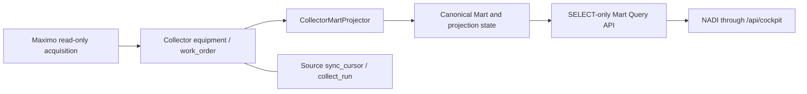

# NADI-AUD-02A — Mart Projection Coverage & Recoverable Replay

## 1. Executive summary

**Discovery/design PASS; F-03 remains OPEN for implementation and operations.**
The omission mechanism is **VERIFIED from current source**, not a measurement of
historical plant data loss. Seven scenario groups (A–G) and six ranked gaps are
reviewed below. Concurrent interleavings and crash outcomes have a deterministic
test design but were **not newly reproduced**: this task permits existing tests
only. Existing full Collector suite: **202/202 PASS**, no skipped tests or external
I/O; this does not establish the proposed recovery design works.

An old WO skipped because its Equipment is absent from the **local Collector**
can fall below the one-day overlap after a newer whole-table maximum is saved.
Repairing that dependency without changing the WO timestamp does not make the WO
eligible again. Mapping exceptions can be skipped with the same checkpoint
consequence. Conversely, **writer validation/persistence exceptions are fatal**
and do not reach the new state save; do not conflate these paths.

A qualification to the original hypothesis: Equipment present locally but absent
from Mart is a different case. The current dependency set is not a target-Asset
lookup, and canonical relationships intentionally have no hard foreign keys.
A valid WO can be persisted with an unresolved logical target; it is not necessarily
skipped or rejected by PostgreSQL. Existing integrity auditing acknowledges such
references. A new target-readiness policy needs explicit review, not a global FK.

Recommended minimum correction: a bounded immutable input manifest in the existing
owner store, atomic target/disposition receipts, a durable deferred ledger and
bounded replay independent of source timestamps. Keep scan progress distinct from
complete coverage; never report complete while scoped obligations remain. A full
local manifest baseline avoids pretending the current schema has a reliable local
change sequence. A scalable incremental journal is an alternative requiring a
broader writer-coverage decision. Nothing in this proposal is implemented here.

## 2. Baseline and scope

- Verified remote main: `4914a73fc7b640b6dd0667d0450fdb12aa04c452`.
- Branch: `codex/nadi-aud02a-mart-discovery`; isolated clean worktree created from
  that main; only this report may change.
- [PR #91](https://github.com/johnd-creator/reliability-knowledge-starter/pull/91)
  MERGED at that main; reviewed source `f16ff508f07efd56535553f49e6f0007273a44e0`.
- [PR #93](https://github.com/johnd-creator/reliability-knowledge-starter/pull/93)
  remains separate OPEN/DRAFT at `1a6bbd22c7f5f5129e45239ba7bd1e3e788f5c44`.
  No roadmap/status/DEV-LOG amendment is included in this branch.
- [Astra PR #90](https://github.com/johnd-creator/reliability-knowledge-starter/pull/90)
  remains independent OPEN/DRAFT at `c20a764ccae892a5bb0972a59591e3f83984b0d9`.
  Its [F-03 hypothesis](https://github.com/johnd-creator/reliability-knowledge-starter/blob/c20a764ccae892a5bb0972a59591e3f83984b0d9/docs/audits/NADI-ASTRA-HIGH-INDEPENDENT-AUDIT.md#f-03--local-mart-checkpoints-do-not-guarantee-recoverable-coverage)
  is checked against main, not treated as merged authority.
- Preflight inventoried 57 existing worktrees. Original root branch
  `feature/pi-governed-source-adapter` remained at `0c800dac1da6ef863afdb193021176fe7feac073`.
  Its original untracked `23496711.xls` and five existing `next-env.d.ts` changes
  in other worktrees were preserved. The new worktree adds one, without switching
  any existing checkout or inspecting the running application.
- Root/component AGENTS and existing owner/runbook boundaries apply. Graph lookup
  used Tier 2, generation `2026-08-24T09:24:57Z`. Current branch source was read
  directly for missing/stale coverage. Cross-component graph call bindings were
  not accepted as proof of the actual Database/reader dependencies.

Evidence terms: **VERIFIED** = direct pinned source/existing assertion establishes
behavior; **SUPPORTED** = source supports a conditional interleaving/policy risk,
with new fault injection still pending; **UNKNOWN** = runtime occurrence/count,
actual configuration or evidence not inspected. Operational proof is marked
**REQUIRES_OPERATOR_APPROVAL**. No live DB, source, runtime/status HTTP endpoint,
collector, replay, migration, container or monitoring action was used.

## 3. Current data-flow architecture



The existing managed owner is **Maximo Collector PostgreSQL**; its operational
Collector tables and canonical Mart coexist in `maximo_collector`, not in the
legacy Cockpit store. The diagram separates logical boundaries, not databases to
be created. Actual current DSNs/roles were deliberately not queried. Projector
construction accepts separate Database objects; that abstraction does not prove
cross-database atomicity or authorize redirecting a store. [E01, E03, E17]

| Boundary | Actual behavior / ownership |
|---|---|
| Maximo → Collector | Existing read-only authenticated acquisition and owned source store. AUD-01 now holds generic source checkpoints on unresolved processing errors; specialized WO recovery remains separate. No acquisition was run. [E15] |
| Collector → projector | Local `equipment` or `work_order`, ID-ordered OFFSET/LIMIT pages in separate sessions; no Maximo client. Default500 rows, permitted1–5000. `incremental=True` without prior state falls back to full. [E02–E04] |
| Identity / transform | Equipment mapping requires stored BSR/IP proof. WO uses configured prefix, normalized local equipment identity and reconstructed allowlisted scalars; actual start/finish are NULL. Scoped canonical IDs are deterministic, not fuzzy matches. [E04, E06] |
| Relationships | Equipment IDs cached from Collector at run start; not Registry membership or target Asset existence. Soft canonical references permit unresolved targets; integrity auditor measures target resolution. [E03, E05, E08] |
| Target persistence | Each canonical batch validates schema/scope, then commits in its own Mart session by canonical ID; identical content is unchanged. Run state is another transaction after all pages. [E05, E07] |
| Progress / retry | `sync_cursor` belongs to source acquisition; `mart_projection_state` belongs to downstream projection. Neither substitutes for the other. No per-row obligation/attempt history exists in the examined projector/state path. Existing loop repeats incremental passes; it is not deferred-record replay. [E09, E12, E15] |
| Query / NADI | Dedicated SELECT-only reader, explicit Mart DSN with no legacy fallback; normal Maintenance/Asset populations use the business Registry. Technical context counts do not establish registered Asset completeness. Next rewrites `/api/cockpit` to its configured Cockpit API. [E01, E13, E17] |

## 4. Source evidence and code references

All line references below bind to baseline main above. Ranges identify the actual
implementation; report proposals do not describe existing capabilities.

| ID | Exact source / relevant lines | Material evidence |
|---|---|---|
| E01 | [Mart runtime](../../reliability-cockpit/docs/mart-runtime.md), L10–40; [Query API](../../reliability-cockpit/docs/reliability-mart-query-api.md), L21–24, L63–85 | Owner, separate reader/admin/legacy roles, Registry and source-date semantics. |
| E02 | [local_mart_projector.py](../src/services/local_mart_projector.py#L35-L75), L35–75 | One-day overlap; report counters exist in memory/output, including skip reasons and NULL timestamps. |
| E03 | [projector state/dependencies](../src/services/local_mart_projector.py#L162-L218), L162–218 | Separate state sessions; unconditional SUCCEEDED save; dependency set from local Equipment IDs. |
| E04 | [project traversal](../src/services/local_mart_projector.py#L220-L297), L220–297 | OFFSET over mutable input; scope/mapping skips; per-batch writer; whole-table MAX; completion/state; assets then maintenance. |
| E05 | [Mart writer](../src/services/mart.py#L262-L338), L262–338; [integrity auditor](../src/services/mart.py#L348-L410), L348–410 | Contract validation raises; per-batch canonical-ID write/commit; soft-reference resolution reporting. |
| E06 | [canonical mappers](../src/adapters/maximo/canonical_mappers.py#L79-L148), L79–148; [identity](../src/canonical_identity.py#L15-L43), L15–43; projector L92–159 | Source objects/scoped identities, scalar allowlist and NULL actual times; no invented values or identity joins. |
| E07 | [Database.session](../src/repositories/database.py#L18-L46), L18–46 | Engine has no run-wide snapshot setup; each session closes, rolls back on exceptions; projector/writer transactions are separate. Actual operational isolation is UNKNOWN. |
| E08 | [Mart model](../src/repositories/mart_models.py#L220-L231), L220–231; [base SQL](../migrations/002_reliability_mart.sql#L1-L61), L1–61 | Latest-state row only; relationships intentionally soft, not a hard-FK failure assumption. |
| E09 | [source models](../src/repositories/models.py#L179-L202), L179–202; [projection SQL](../migrations/003_reliability_registry_projection.sql#L20-L28), L20–28 | Distinct source cursor/run log and downstream state; no persisted deferred identities in this state. |
| E10 | [IntegrationMartReader](../../reliability-cockpit/src/repositories/integration_reader.py#L18-L45), L18–45 | Selects latest status/success times for both domains; does not reconcile deferred rows or skipped counts. |
| E11 | [IntegrationStatusService](../../reliability-cockpit/src/services/integration_status.py#L18-L69), L18–69; [status types](../../reliability-cockpit/src/domain/integration_status.py#L14-L20), L14–20 | Independent freshness dimensions; latest Mart activity can appear CURRENT under valid supplied policy despite hidden omission. No current policy is assumed or changed. |
| E12 | [CLI](../src/cli.py#L545-L556), L545–556; [Compose source](../../compose.yaml#L235-L248), L235–248 | Local-only project command; failures exit2; published loop sleeps/repeats without a durable retry queue. Runtime override/process state was not inspected. |
| E13 | [MartQueryRepository](../../reliability-cockpit/src/repositories/mart_reader.py#L198-L224), L198–224; [route](../../reliability-cockpit/src/api/reliability.py#L1061-L1068), L1061–1068 | Registry-scoped maintenance read and API serialization, no repair on read. |
| E14 | [local projector tests](../tests/test_local_mart_projector.py#L19-L109), L19–109; [writer tests](../tests/test_mart.py#L61-L115), L61–115, L218–237 | In-memory SQLite, idempotency/CAN preservation, unproven scope, Registry atomicity, no hard FKs, schema/scope checks. Not late-dependency/concurrent/crash tests. |
| E15 | [AUD-01 sync](../src/services/sync.py#L81-L103), L81–103, L275–282; [store cursor](../src/repositories/store.py#L394-L426), L394–426 | Source checkpoint strictness and durable source-run log are not Mart checkpoint guarantees. |
| E16 | [migration manager](../../reliability-cockpit/src/services/mart_migrations.py#L18-L32), L18–32; [integration schema](../../reliability-data-contracts/schemas/integration-status.schema.json), L24–26, L228–247; [EvidenceModel](../../reliability-cockpit/src/domain/condition_evidence.py#L18-L19), L18–19 | Existing governance allowlist/checksum ledger and strict DTOs; additive JSON fields are not automatically compatible with extra-forbid consumers. |
| E17 | [writer DB selection](../src/services/local_mart_projector.py#L78-L89), L78–89; [reader DB](../../reliability-cockpit/src/repositories/mart_database.py#L52-L84), L52–84; [Next config](../../reliability-cockpit/web/next.config.js#L7-L13), L7–13 | Writer-local fallback differs from public reader's explicit DSN/read-only boundary; browser proxy is configuration, not a new source collector. |
| E18 | [prior MX-012R report](mx-012r-unified-collector-mart-pipeline.md#projection-state-and-reruns), L47–85; [CanonicalCollection](../src/services/canonical.py#L50-L57), L50–57 | Historical skips are documented, not fresh counts; a default UNKNOWN collection completeness is not a coverage receipt. |

## 5. Astra F-03 verification

**VERIFIED source trace, not a newly executed regression:** start with no saved
state, WO `BSR-OLD` at T1 and no local Equipment E; another eligible WO at T2,
where T2−T1 exceeds one day. The projector increments missing-equipment skip for
OLD, writes other valid rows, reads MAX=T2 from the whole local table and saves
SUCCEEDED. Add E later and project its Asset, leaving OLD at T1. Incremental
selection now requires `source_changed_at >= T2−1 day` (or NULL), excluding OLD.
No durable OLD obligation exists to override this filter. OLD remains in Collector;
this is a potential Mart coverage omission, not evidence source data was deleted.
[E02–E04, E09]

Existing mitigation: repair while the row is still within overlap, use a separately
approved full **local** scan, or update the local projection eligibility through a
real source change. None was invoked. A full scan is an existing option, not the
proposed normal dependency-recovery mechanism and not authorization to rewind any
source cursor. The earlier controlled-bootstrap report records nonzero dependency
skips but does not prove which are recoverable/missing today. Current operational
omission count and history: **UNKNOWN / REQUIRES_OPERATOR_APPROVAL**. [E18]

For concurrency, the code verifies a weaker fact: batches use distinct sessions
and the final MAX has no captured upper input fence. A late changed row may itself
be reselected next pass due to overlap; do not label every such race permanent
loss. Specific combinations of shifting page membership, old inserts/updates and
uncovered MAX advancement can omit eligible versions. These interleavings are
**SUPPORTED**, with executable regressions pending AUD-02B. [E04, E07]

## 6. Failure-scenario matrix

New fault injection for every row below is feasible with synthetic fixtures but
**PENDING**, not run in this docs-only task. Existing tests provide only the
explicit mitigations cited; no operational occurrence is inferred.

| Group | Current behavior and supporting evidence | Risk / affected population | Current mitigation | Required correction / confidence |
|---|---|---|---|---|
| A — missing Equipment | Missing/blank local identity is skipped; counters are transient; state may advance. If only target Asset is absent, local membership passes and soft-reference writer can persist unresolved WO. [E03–E05, E08] | In-prefix WO without local dependency, plus target-only unresolved relations; no measured affected count. | Source row retained; project_all orders Asset before WO; integrity auditor can count persisted unresolved refs. | Durable source-identity obligation; distinguish local dependency from target readiness. Omission path VERIFIED; target-policy consequence SUPPORTED. |
| B — late repair | Adding Equipment does not alter old WO timestamp; fixed overlap cannot find OLD beyond its lower bound. [E04] | Old non-NULL WO/mapping failures; NULL rows remain eligible. | Overlap or explicit full local scan, neither a durable recovery guarantee. | Replay by obligation key independent of timestamp; no global rewind. VERIFIED source mechanism. |
| C — concurrent mutation | ID ordering is deterministic in a fixed population, but OFFSET positions/filter membership can shift. Final whole-table MAX is read later and may exceed processed versions. [E04, E07] | Concurrent inserts behind offset can be missed/duplicate earlier rows; removal/filter exit can skip next row. Late updates may only cause temporary lag; old/backdated versions are at greater risk. | Canonical upserts absorb duplicates, overlap catches some versions; neither proves snapshot coverage. | Immutable bounded manifest/snapshot and proven receipts. Conditions VERIFIED, exact interleavings SUPPORTED, reproduction PENDING. |
| D — crash boundaries | Batch commits precede state commit. Crash before state save retains old checkpoint; identical replay is idempotent if eligible. Crash after state save follows prior batch commits, but skipped rows can already be hidden. No durable STARTED/FAILED attempt. [E03–E05, E07] | Partial target progress and stale success metadata; not automatic evidence of lost successful writes. Ambiguous commit outcome needs recovery evidence. | Transaction rollback per batch; deterministic ID upsert; prior checkpoint survives pre-state crash. | Same-transaction target/disposition receipts, restartable run and fenced progress; crash tests PENDING. Separation VERIFIED; process/PG crash behavior SUPPORTED. |
| E — mapping/contract | Asset mapper exception and missing scope proof both become skipped_unproven_scope. WO mapper exception becomes skipped_mapping. Writer schema/scope/DB failure raises before state save; earlier batches remain. [E04–E05] | Silent omissions on mapper path versus fatal attempt with old success on writer path; intentional prefix exclusion must stay separate. | Writer validates whole batch, rolls back DB transaction and CLI exits2; existing scope tests PASS. | Durable explicit disposition/reason, sanitized failure class and attempt status; never suppress a fatal writer error as expected exclusion. VERIFIED. |
| F — timestamps | NULLs are always eligible; inclusive >= handles ties under stable traversal; PK ordering is not timestamp ordering. Old non-NULL updates/inserts below lower bound are ignored. MAX can include skipped/out-of-prefix rows, not just written ones; no check prevents watermark regression or future skew. [E02–E04, E09] | Timestamp-only coverage fails for late/backdated input; NULL repeats can cost work; tied timestamps do not cure OFFSET races. | NULL counter, one-day overlap and deterministic PK order; timezone-naive state/MAX treated as UTC, not validated source-time provenance. | Local captured version/fingerprint and explicit NULL handling; keep source dates as diagnostics, never sole progress proof. VERIFIED selection behavior; runtime anomalies UNKNOWN. |
| G — status reconciliation | All nonfatal scans set completed and persist SUCCEEDED; skip reasons/NULL counts are not in state. Fatal latest attempt leaves old success. Reader checks two latest statuses/times and applies existing freshness policy, not per-run omissions. [E02–E03, E10–E11] | Fresh activity can be mistaken for covered population; source freshness, intentional exclusion, unresolved dependency and aborted run are not interchangeable. | Reader requires both projection timestamps, no business-changedate fallback, distinguishes availability/other trust dimensions. | Durable run/outcome/reconciliation and conservative legacy adapter; no freshness-policy change. VERIFIED, actual UI/runtime classification UNKNOWN. |

## 7. Coverage/checkpoint invariants and ranked gaps

**Required invariants:** source `sync_cursor` never changes through projection;
selection belongs to an immutable bounded run generation; each captured item/version
has exactly one durable disposition; scanning may pass a deferred item only with an
atomic obligation receipt; covered progress cannot exceed receipts; COMPLETE needs
no unresolved obligations in scope (including older generations), not simply loop
termination. Retries cannot downgrade newer target state or silently erase debt.
Expected exclusions require explicit policy and evidence. NULL/source dates never
stand in for local revision identity. Historic unknowns remain UNKNOWN.

All gaps reference **Astra F-03**. Severity concerns the described repository
mechanism, not an assessed plant incident. Operator approval below means target
preflight/migration/replay, never authority to execute those here.

| Gap / priority | Root cause / exact affected module | Scenario / integrity impact | Minimal correction / required tests | Operational dependency / compatibility risk | Status |
|---|---|---|---|---|---|
| AUD02-G01 / HIGH | local_mart_projector.py L237–271,L284–290 + state model L220–231: skipped identity not durable; overlap excludes old rows | A/B/E: repaired dependency/mapping stays unprojected while cursor advances | Obligation ledger + bounded timestamp-independent retry; T01/T02/T08/T13 | Owner-approved initial debt inventory; additive schema and retained legacy debt | VERIFIED |
| AUD02-G02 / HIGH | projector L235–245,L284–285; Database.session L37–46: mutable OFFSET and unbounded final MAX | C/F: no proved input fence; page shifts and uncovered versions | Stable manifest/keyset within one captured population; T03/T04/T10/T11/T14/T17 | Snapshot/storage/latency budget approval; no claim a max timestamp or max ID alone is safe | SUPPORTED interleavings; source conditions VERIFIED |
| AUD02-G05 / HIGH | projector L189–211,L288–290; integration_reader.py L34–45: unconditional latest success without coverage reconciliation | G: latest activity can hide deferred/fatal attempts | Run ledger, completeness gate and legacy status adapter; T12/T16 | AUD-11 vocabulary owner; strict DTOs forbid casual fields/enums; thresholds unchanged | VERIFIED |
| AUD02-G04 / MEDIUM | projector L251–271 + report L43–75: scope proof, mapping exceptions and deliberate exclusions conflated or not retained | E/F: no durable explanation/retry identity for silent mapping omission | Explicit EXPECTED_EXCLUSION vs DEFERRED vs FAILED; T08/T09/T10 | Data-owner exclusion policy; never turn unknown scope into approved out-of-scope | VERIFIED |
| AUD02-G03 / MEDIUM | projector L185–211,L274–290; mart.py L312–337: separate commits, no run receipt/lease in this path | D/G: partial target progress and old success survive crash; concurrent invocations can overwrite latest state | Atomic disposition/target transaction, run lease/fencing and resumable acknowledgments; T05/T06/T07/T14/T18 | Same-owner/DB verification, transactional refactor preserves existing writer callers; no distributed transaction assumed | VERIFIED separation; crash/concurrency consequence SUPPORTED |
| AUD02-G06 / MEDIUM | projector L213–218,L264–269 + logical-reference schema: local identity set does not establish target Asset coverage | A: technical row can yield unresolved canonical relation | Explicit local/target dependency policy and indexed scoped resolution; T01/T19 | Senior decides defer-vs-unresolved eligibility; preserve intentional soft references, Registry rules and other canonical domains | SUPPORTED policy gap; lookup behavior VERIFIED |

## 8. Deferred-record recovery and traversal design

### Strategy comparison

| Candidate | Benefit | Limitation / decision |
|---|---|---|
| Increase overlap or use successful-row MAX | Small change | Reject as correctness fix: finite overlap cannot recover arbitrary old debt or prove concurrent coverage. |
| Keyset `(source_changed_at,id)` plus start MAX | Removes OFFSET movement within stable values | Alone insufficient: NULL/backdated/equal-date content changes and mutable selection remain; timestamp is not a committed local change sequence. |
| One long repeatable input snapshot, write targets directly | Stable input version set | Bounded only with caps/deadline; long transaction/restart/vacuum costs; does not by itself preserve deferred work. Requires disposable PostgreSQL proof. |
| **Bounded immutable manifest + durable receipts** | Explicit frozen membership/version, resumable paging and debt, no Collector writer changes | Recommended minimum for reviewed owner/co-location; full local capture cost/storage budget must be accepted. No false incremental guarantee. |
| Transactional local change journal/outbox | Scalable local incremental capture, including old-date updates | Alternative later scope: must cover every local writer/import and commit inversion. A bare BIGSERIAL/MAX checkpoint is not sufficient if an earlier allocated ID commits late. Use pending/acked obligations, not skip-by-max. |

The manifest design is a proposal for **latest local state projection**, not a
historical version archive. There is no reliable local per-row commit revision in
current Equipment/WO models [E09]. Do not invent one from `source_changed_at`,
`mart_updated_at`, time of Python fetch or a source-cursor value.

### Capture and work budget

1. Verify expected Maximo/Mart database owner/co-location and writer capability in
   a separately approved preflight. Initial implementation fails closed for
   unreviewed cross-database layouts; no new DB, DSN fallback or Cockpit store.
2. Create a run ID, contract/mapper/policy epoch and single-domain fencing token.
   Establish a consistent input snapshot and capture a finite manifest using
   deterministic PK keyset order **inside that snapshot**. Candidate PostgreSQL
   transaction behavior must be proven in disposable tests, not assumed from SQLite.
3. Capture current local rows, including NULL/backdated timestamps, without the
   old timestamp-only correctness filter. Preserve each item's row identity,
   scope-proof status, input fingerprint and only the minimal allowlisted typed
   projection inputs needed for reproducible mapping. No raw sources JSON,
   personnel fields or source secrets. These temporary work inputs are distinct
   from the payload-free long-lived obligation ledger below.
4. Capture has an approved row/byte/time cap and transaction deadline. If exceeded,
   abort capture and publish no completed manifest/checkpoint. A snapshot cannot
   be silently resumed in a new snapshot under the same generation. Choose a
   different capture/journal design if the actual population exceeds the budget.
   No full-table write lock or operational collector pause is assumed acceptable.
5. Commit the sealed manifest before target work; process at most a configured
   batch/work/time budget per invocation, using immutable item ordinal/keyset and
   a durable continuation. A large sealed manifest can span calls/restarts.
   Later insertions/changes are handled by the **next capture generation**,
   including backdated versions; they are not retrospectively called covered.
6. Subsequent full local captures cost reads, but unchanged fingerprints can avoid
   target rewrites. This is finite local reconciliation, **not a source/global
   rewind** or a new Maximo acquisition. In contrast, repair of an already deferred
   row uses only its obligation key and never requires rescanning all rows.
   Future journal optimization needs separate writer coverage and commit-order proof.

### Durable minimal ledger candidates (names provisional, no DDL supplied)

| Relation / fields | Purpose and constraints |
|---|---|
| projection_run: run_id, domain/scope/epoch, status, started/heartbeat/finished, manifest identity/count, scan continuation, written/unchanged/excluded/deferred/failed counts, last complete generation | Durable attempt and coverage basis; latest activity distinct from last complete. Missing historical fields remain UNKNOWN. |
| projection_work_item: run_id + ordinal, source_object/PK, proven/expected scope, input fingerprint/version, minimal typed allowlisted input, disposition/receipt version | Unique run/item and run/source identity; temporary data required for restartable snapshot mapping; bounded capture and retention, no unnecessary source copy. |
| projection_obligation: stable ID, domain, source object/PK, expected scope + proof flag, target identity if derivable, dependency kind/scoped key, reason family/code, mapper/contract epoch, fingerprint, first/last attempt, attempt count, next eligible time, state, lease/fence, resolution receipt/run | Payload-free durable debt; update reason/revision through bounded audit transitions, not duplicate or silently delete. Store sanitized class/code, not arbitrary exception text or raw payload. |
| projection_target_receipt / obligation transitions | Sidecar projection generation/version per target plus durable transition references; protects against stale writer/replay overwriting newer target coverage without changing canonical DTO identities. |

Use normalized non-NULL uniqueness keys for expected scope/source identity; an
UNKNOWN proof is not manufactured BSR/IP provenance. One active obligation per
source/domain/policy identity, with explicit dependent-key entries if several
requirements are unmet; version/reason changes update its audited lineage. A new
version supersedes old debt only when replacement coverage or linked replacement
obligation is durable. Required indexes support due-state/domain/scope and dependency
lookups; never load every Equipment ID into memory as proof of target coverage.

Pending/blocked debt is never expired away to obtain PASS. Retain resolved audit
references/counts according to owner-approved retention; historical payloads need
not persist. Missing/deleted local input is BLOCKED/UNKNOWN until an approved
absence policy, not automatic resolution or target deletion.

### Atomic application and replay

- Refactor MartWriter to allow a caller-owned transaction **without changing the
  current default behavior for existing controlled canonical callers**. In the
  new co-located path, target upsert, item disposition, obligation update and
  receipt commit together. Do not chain today's independently committing writer
  and `_save_state` and call that atomic. [E05, E07]
- Use a short domain state/lease fence checked inside the write transaction;
  stale/replaced owners cannot commit. Candidate generation/target-receipt CAS
  prevents old replay overwriting a newer projected version. Source timestamp
  order alone is insufficient. Check actual target content against its sidecar
  receipt too: an unchanged source fingerprint does not prove another writer did
  not change the target. Concurrent canonical writers require shared fencing and
  receipt compatibility or a fail-closed conflict. A projector-only lease cannot
  fence legacy code that does not participate; initial rollout must exclude
  unqualified same-target projector/bootstrap/controlled-load writers. This does
  not require pausing source acquisition.
- A scanner may advance its **scan continuation** across a deferred row only when
  that obligation receipt commits. **Complete coverage** remains held until all
  in-scope debt is resolved/excluded with evidence, including older generations.
  No new use/reset/mutation of `sync_cursor`; no timestamp watermark is proof of
  such coverage. Legacy watermark remains diagnostic/compatibility metadata.
- Bounded replay selects due obligations with fairness/attempt/time limits and a
  reviewed backoff/quarantine policy. Missing dependency waits, rather than tight
  looping; poison records become visible BLOCKED_NEEDS_REVIEW, not resolved after
  a retry cap. Reuse the existing projection invocation boundary, not a new daemon
  or automatic scheduling change.
- Replay reads that exact local source identity, checks current scope and mapper
  epoch, then the scoped target dependency. If input changed, bind a new validated
  version before application; do not replay a stale stored source copy. Canonical
  IDs/upsert semantics remain; business Registry membership is never auto-expanded.
  Successful resolution is committed with its target receipt. No Maximo request.
- Crashes before commit leave no acknowledged progress; crashes after commit can
  recover the receipt and avoid duplicate writes. A lease expiry alone is not a
  success. Resume uses durable item state, not a new OFFSET into mutable tables.

## 9. Migration compatibility analysis

Propose additive Maximo/Mart-owned run/work/obligation/receipt relations and nullable
or defaulted compatibility metadata only. Reserve a **new reviewed migration ID**,
not edits to deployed 002/003 or existing ledger checksums. Do not assume the
Cockpit governance migration runner already accepts this: its current FILES and
READ_TABLES are explicit and limited [E16]. Senior/data owner must choose the
canonical application/packaging/checksum path, exact owner and minimum grants.
No SQL migration, migration helper, grant or schema was created/executed here.

Keep source/target IDs, canonical Contract1.0 entities, existing `mart_projection_state`
columns and Registry membership. `last_success_at` becomes last **complete** coverage
only in the reviewed new path; retain separate attempt times. Unknown legacy
SUCCEEDED is not retroactively certified. Initial debt inventory must be a bounded
local reconciliation after explicit approval, not fabricated ledger backfill.
Rows no longer in the local store cannot be recovered from this design alone.

Candidate rollout order: approved private backup and restore drill on a disposable
clone; owner/anchor/schema/checksum/grant/drift preflight; reviewed additive migration;
conservative reader capability detection (legacy coverage UNKNOWN); new writer with
schema/epoch/fence handshake; explicitly authorized initial local capture/replay;
exact-version disposable regression and operator coverage/load acceptance. No step
is authorized/executed by this discovery. Never initialize a new operational DB,
change Compose identity, restart collectors or enlarge source schedules to apply it.

The existing reader already treats last_status != SUCCEEDED as degraded; PARTIAL/
FAILED is safer than keeping a fresh SUCCEEDED, but new reader logic must verify
coverage ledger capability and not trust unverified legacy success. A legacy
writer updating old status fields without a matching fenced receipt must invalidate
that coverage claim; the presence of a leftover run ID alone is insufficient. Existing public
DTOs reject unknown fields/enums [E16]. First integrate new internal records into
existing trust-state/PROJECTION_ERROR semantics; expose new detailed coverage only
through a separately reviewed versioned/opt-in contract and sanitized aggregates.
No arbitrary JSON extension or policy/threshold change is assumed compatible.

Downgrade: retain new tables, manifests, obligations and audit; never drop pending
work, rewrite history or reset a cursor to make old code run. An old writer ignores
the debt and can reassert misleading SUCCEEDED, so rollback to it is **not inherently
safe**. Use a reviewed compatible writer/reader or an operator-approved projection-
only pause preserving debt; leave acquisition services and public read-only boundaries
alone. A projection pause/rollback decision is still an operational action
requiring approval, not an automatic instruction from this report.

## 10. Synthetic test plan

All new scenarios below are **DESIGNED / NOT IMPLEMENTED / NOT EXECUTED**. Fixed
synthetic identities, UTC clock, finite populations/budgets and fault hooks are
required. `scan` means acknowledged manifest continuation; `complete` means verified
coverage generation, never source `sync_cursor`, which must remain byte-identical.

| Test | Fixtures / deterministic fault | Expected target/disposition | Checkpoint and required assertions |
|---|---|---|---|
| T01 old WO missing local Equipment | OLD/T1 + valid NEW/T2, T2−T1>overlap, E absent | NEW only; one durable OLD missing-local obligation | scan may pass OLD only with receipt; complete held; PARTIAL, no source cursor writes |
| T02 repair beyond overlap | Restart; add E and scoped target Asset; OLD timestamp unchanged | Exactly one OLD target; resolve debt by key | No full rescan/global rewind/source request for replay; complete advances only after debt clear |
| T03 insert between pages | Seal manifest; inject new key before previous page boundary, including old-date row | Current generation writes its exact items; next generation includes inserted row | No duplicate/missed manifest items; insertion not falsely covered in old generation |
| T04 mutate between pages | Change already fetched row/version and eligibility; inject higher source MAX | Captured version remains explicit; later generation handles changed/backdated version | No later mutable MAX can certify uncaptured version; target receipt prevents stale overwrite |
| T05 crash after target write before commit/progress | Inject before shared commit, and after commit before caller sees acknowledgment | Before commit rolls back target/disposition; after commit receipt survives | No progress without receipt; retry reconciles ambiguous acknowledgment, not duplicate row |
| T06 restart/resume | Stop after finite acknowledged batch, construct new process/service | Resume unacked ordinal; earlier target/disposition stable | No new OFFSET query/full recapture under same generation; complete remains held until done |
| T07 duplicate retry | Run same due obligation twice with same validated fingerprint | One canonical target and resolution receipt; created_at preserved | No double count/completion or audit gaps; compare expected receipt revision |
| T08 mapping vs validation error | Missing required mapper field; separately invalid canonical schema and failing writer | Mapping creates durable reason; writer failure follows explicit fatal/partial policy and rollback | No SUCCEEDED on omission/fatal; no swallowed contract/scope error or private text in ledger |
| T09 proven exclusion vs unknown scope | Out-of-prefix WO; asset without site/org evidence | Proven exclusion receipt only for approved predicate; unknown proof deferred/blocked | Neither invented scope nor false error-free global coverage; business Registry unchanged |
| T10 NULL timestamp | Valid NULL row plus NULL-row mapping failure | Valid maps without artificial date; failure durable | No NULL date substituted with now/zero; finite work/replay, no starvation |
| T11 identical timestamps | More than two batches share same timestamp, shuffled IDs | Every distinct captured ID once; duplicate retry unchanged | Keyset/manifest total reconciles; ties do not silently skip at page edge |
| T12 partial vs complete status | Unresolved older debt plus otherwise completed current scan | PARTIAL and explicit attempt/coverage counts | COMPLETE denied until debt clear; last complete time not refreshed by partial attempt |
| T13 persistent poison | Same failing obligation across bounded invocations | Attempts/backoff/audit preserved; visible blocked state at reviewed escalation | Limits enforced, no tight loop or auto-delete; source/target untouched for failed item |
| T14 large interrupted continuation | Manifest bigger than page budget, within capture cap; interrupt midway | Resume next invocation using retained manifest and receipts | Batch/time/byte budgets, no falsely complete partial population; capture over cap fails closed |
| T15 AUD-01/WO/baseline compatibility | Existing recovery, recency and asset baseline fixtures | Source store/cursor policy and canonical IDs unchanged | Existing test_cursor_recovery/test_workorder_recency/test_asset_baseline all PASS; no acquisition invocation |
| T16 failed/aborted latest attempt | Prior recent complete; inject fatal failure/process exit in new run | Durable failed/aborted or lease-expired unfinished attempt | Old success cannot masquerade as latest completed coverage; freshness policy unchanged |
| T17 old/nonmonotone source dates | Insert/update after capture with date below previous lower bound | Next local capture includes new fingerprint | No reliance on greater source date/local wall time as update sequence; no backwards coverage proof |
| T18 stale/concurrent worker | Expire lease; second worker/generation commits first; release old writer | Old token/CAS rejected; receipts and newer target preserved | No checkpoint overwrite/double resolution; attribution failure fails closed |
| T19 local identity vs target readiness | Local Equipment exists but Asset projection invalid/missing; valid canonical WO | Apply explicitly approved defer/unresolved policy, not an assumed FK error | Relationship coverage visible; do not alter other domains' allowed soft references |
| T20 migration/legacy adapter | Existing legacy state/cursors + old readers/writers; capability absent/drift | Legacy coverage UNKNOWN; incompatible writer refuses startup, records preserved | Additive migrations idempotent/checksummed in disposable PG; no operational apply/drop/grant action |

Future PostgreSQL MVCC/commit/crash qualification must run on an explicitly disposable
fixture under AUD-02B authorization, never on the operational DSN. Cockpit
`test_projection_acceptance.py` contains optional Node/isolated-PG cases and
migration fixtures; they were read for boundaries, **not executed** here [E16].

### Existing isolated validation actually executed

The already reviewed `.github/scripts/maximo_ci/run_offline.py` was run unchanged:

```text
PYTHONDONTWRITEBYTECODE=1 <existing component interpreter>   .github/scripts/maximo_ci/run_offline.py --root maximo-collector   --sha 4914a73fc7b640b6dd0667d0450fdb12aa04c452   --report /tmp/nadi-aud02a-existing-tests.json
```

Python **3.14.3**, 202 discovered/executed; failures0/errors0/skips0/expected-failures0/
blocked-external-I/O0; PASS. Interpreter was reused, imports rooted in this isolated
worktree; no runtime startup or package install. Guards precede imports/discovery,
suppress private dotenv, reject network/subprocess/external DB, allow in-memory
SQLite only. Local result is preliminary existing-regression evidence, not a new
F-03 reproduction or supported-Python deployment acceptance. Exact-head hosted
CI on the docs PR is recorded independently in its checks/handoff.

| Existing modules actually executed | Count / scope |
|---|---|
| test_local_mart_projector | 4: idempotency/CAN, unproven scope, Registry resolution and atomic invalid-snapshot rejection |
| test_mart | 13: all entities, canonical-ID upserts, soft refs/integrity, scope/contracts, transaction validation, dates |
| test_controlled_mart_load | 4: finite fake-source loader, deduplication, dry-run and idempotent owned-store behavior; no live load |
| test_cursor_recovery / test_workorder_recency / test_asset_baseline | 21 / 38 / 4; existing source/specialized-path compatibility |
| Remaining existing Collector modules | 118; full total202, not 202 additional to the rows above |

## 11. AUD-11 integration vocabulary

Candidate internal names, subject to coordinated approval; no new public enum or
AUD-11 implementation is made here.

| Candidate outcome | Exact meaning / existing compatibility |
|---|---|
| STARTED / RUNNING | Durable attempt and fenced input capture/processing; not a success timestamp. |
| SUCCEEDED / COMPLETE | Sealed input fully reconciled; no unresolved scoped debt; only this refreshes complete-coverage time. Distinguish source-snapshot scope/time from present-time global completeness. |
| PARTIAL / DEFERRED | Some writes/receipts committed and unresolved obligations remain, or finite processing continuation is pending; never full coverage. Existing public TrustState can map conservatively to DEGRADED/STALE with existing PROJECTION_ERROR, not a new enum. |
| FAILED | Fatal contract/persistence/capture failure with no claimed completion; retain prior complete state and per-item receipts. |
| ABORTED | Explicit cancellation/interruption or reconciled abandoned lease; do not silently rewrite unknown process failure as an audited cause. |
| UNKNOWN | Legacy/no attempt evidence, missing schema or uncertain commit/recovery history; never fabricated historical success. |

For each run separate counts of captured, attempted, written, unchanged, intentionally
excluded, deferred and fatal/unprocessed. Counts reconcile the manifest; unresolved
debt across runs is a separate scoped total, not double-counted across retries.
A PARTIAL run may later have all obligations resolved by a new recovery run; preserve
its original outcome and link resolution, do not rewrite history to COMPLETE.
Source synchronization activity, source-record dates, projection activity,
complete-coverage time, quality and policy validity remain independent. No Phase1
threshold, deadline/expiry, review checkpoint or monitoring policy is changed.

## 12. Operational risk and limitations

No current table counts, actual skipped IDs, active DSNs/grants/isolation,
concurrent process ownership, snapshot cost, current freshness verdict, historical
loss or false-alert adjudication was obtained. Those are UNKNOWN. Existing MX-012R
counts are dated repository evidence, not a current inventory. No proof requires
bypassing source controls: the implementation can first be qualified hermetically.

**REQUIRES_OPERATOR_APPROVAL:** actual owner/co-location/schema/grant/cursor
inventory; private backup and restore-drill prerequisites; any additive migration
or grant; initial local debt reconciliation and replay; snapshot/resource/load
measurement on the owner store; controlled projector rollout/pause/compatible
rollback. No Maximo request, collector restart or source rewind is a prerequisite
of the proposed downstream design. New application/tests/schema candidates still
require a separately authorized AUD-02B task, even before operational approval.

All original PNGs/workbook, existing worktrees/backups, QA data/sessions, sources,
collectors/Mart runtime and localhost3000 remain untouched. The 26 pending engineer
decisions and M02/M03/M07 remain unchanged; no PdM semantics/thresholds are approved.

## 13. AUD-02B implementation slices

The following is **READY FOR SENIOR REVIEW**, not implementation authorization.
B1 requires its run/work schema candidate; B2 adds debt. No intermediate slice may
be rolled out as a complete fix before the integrated qualification gate.

| Slice | Prerequisites and exact affected modules (future) | Acceptance / required tests | Rollout restrictions / rollback |
|---|---|---|---|
| B1 — stable capture/progress | D01/D03; local_mart_projector.py, repositories/mart_models.py and new projection repository, additive Maximo-owned migration candidate; Database/MartWriter transaction adapter reviewed | Finite sealed manifest, keyset traversal, receipts/fence, no uncovered MAX. Until B2, any omission holds complete progress. T03/T04/T05/T06/T10/T11/T14/T17/T18 | No new Collector writer trigger/journal without separate scope decision. No operational capture/apply. Keep old state; reject unsafe fallback. |
| B2 — durable deferred obligations | B1 transaction/identity/disposition contract; projection repository/models, local_mart_projector.py, additive ledger migration candidate | Durable unique debt with reason/proof/version/dependency, atomic receipt and PARTIAL status; exclusion not mixed with unknown proof. T01/T08/T09/T12/T13/T19 | Owner approval before DDL/grants; do not rewrite old migration checksums. No obligation deletion/downgrade to old success. |
| B3 — bounded replay | B2; new bounded replay service/repository, reviewed MartWriter session/CAS path, existing CLI invocation wiring only | Repair OLD by key across restart without source GET/full rescan/cursor rewind; fairness, backoff, idempotency and stale-writer rejection. T02/T05/T06/T07/T13/T18 | No new daemon/source acquisition/cadence change; operational replay separately approved. Preserve backlog on pause/rollback. |
| B4 — status/reconciliation | B1–B3; CLI report, integration_reader.py, services/integration_status.py; optional versioned domain/schema proposal only after D04 | Latest attempt and complete coverage distinct; aggregate debt/UNKNOWN legacy behavior, existing public DTO compatibility. T12/T16/T19/T20 plus existing integration assertions | Coordinate AUD-11, preserve policy/PI/Registry contracts. Reader before writer; no raw ledger IDs/payloads exposed publicly. |
| B5 — synthetic/compatibility gate | B1–B4; tests/test_local_mart_projector.py, tests/test_mart.py, new ledger/replay cases, Cockpit integration tests and collector CI lane proposal | T01–T20, existing202 regression, exact-head supported Python lanes; explicitly disposable PG crash/isolation/migration qualification and rollback-readiness evidence | No production/persistent-QA DSN or source access. No rollout/DDL/replay until separate operator authorization; stop on drift or unresolved correctness gap. |

## 14. Senior reviewer decisions required

- **D01 — capture strategy/budget:** approve bounded full local immutable manifest
  as minimum, including minimal sanitized input retention and row/byte/transaction
  limits, or authorize broader transactional journal coverage. Plain keyset/MAX is
  not a sufficient alternative. Actual population/cost remains unknown.
- **D02 — disposition and target policy:** approve expected-exclusion predicates,
  unknown-proof handling and whether local WO projection must defer missing target
  Asset or persist an explicitly unresolved relation. Do not retrofit hard FKs or
  break accepted FMEA/RCFA nullable relationships or Registry membership.
- **D03 — owner/migration/concurrency:** confirm existing Maximo/Mart owner,
  co-location requirement, additive migration ID/checksum runner/grant plan and
  compatible canonical-writer receipt/fencing strategy. No new operational DB.
- **D04 — AUD-11/contract vocabulary:** agree internal outcomes, complete-vs-attempt
  timestamps, CLI outcome/exit-code compatibility, conservative legacy mapping and any separately versioned public
  coverage response; no strict-DTO or Phase1 policy bypass.
- **D05 — replay/retention/rollout:** approve fair budgets/backoff/poison escalation,
  unresolved/manifest retention, initial bounded local debt inventory and safe
  rollback prerequisites; operational execution needs its own authorization.

## 15. Final recommendation

**GO for Senior Review → separately authorized NADI-AUD-02B. NO-GO for operational
remediation, migration, replay or deployment under this task.** F-03's deferred-row
omission mechanism is verified from source; concurrent/crash fault reproductions
remain planned; actual historical loss remains UNKNOWN. Six ranked gaps and twenty
explicit future regression cases are supplied. Existing202 tests PASS but do not
close those new gaps. Application/source code, roadmap/status documents, PR90/93,
operational databases/cursors/collectors/Mart/localhost3000 and engineering approvals
are unchanged. Submit this single-file DRAFT PR and STOP for Senior Review.
