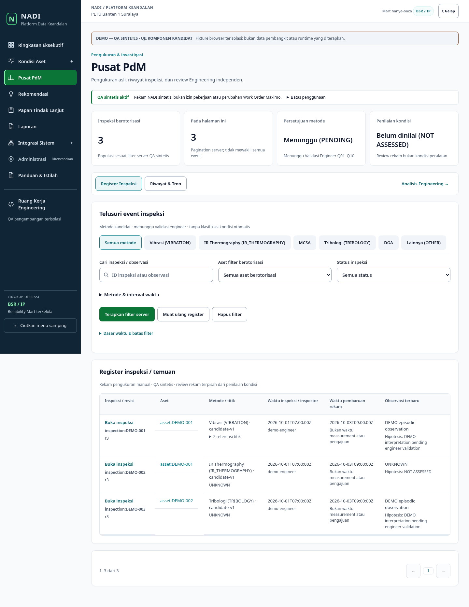

# NADI-UX-V2-OVERHAUL-01 — Design System V2 candidate

Date: 2026-10-18. Implementation and local regression: **PASS within the scope below**.
Product Owner visual acceptance: **PENDING**. Merge: **UNMERGED**.
Live candidate: **LIVE_PREVIEW_NOT_PROMOTED**.

## Baseline and checkpoints

Fetched and reverified `origin/main`: `c7930694187b61ffa6dae90e6a14938e7564c3e7`
(merged PR #101). Isolated branch: `codex/nadi-ux-v2-overhaul-01`.

| Checkpoint | Commit | Completed implementation |
|---|---|---|
| A — Shared system | `268587d` | V2 tokens, scoped presentation, reusable search/disclosure and busy buttons |
| B — PdM | `a1aa64e` | Primary entry action, workspace navigation, compact filters, grouped measurement context |
| C — Engineering | `3c014b9` | Page-local Case search, review action hierarchy, theme-aware workflow fields |
| D — Executive / Assets | `b5b3637` | Source disclosure, readable asset statistics, labeled search and separated actions |
| E — Remaining pages | `43885e4` | Recommendation search, responsive queues, Reports disclosure, contrast fixes |
| F — Quality / delivery | This delivery commit | Browser interaction/axe coverage, 20 screenshot pairs and this report |

Delivery: [Draft PR #102](https://github.com/johnd-creator/reliability-knowledge-starter/pull/102).
Exact final HEAD and backend/frontend CI results are recorded in its verification
section and [attached checks](https://github.com/johnd-creator/reliability-knowledge-starter/pull/102/checks). CI checks out and asserts the PR HEAD
explicitly; it does not test an implicit merge commit. The final delivery response
must report those results after the remote run completes.

## Bounded audit and design decisions

Reviewed the root/scoped instructions, product and design documents, roadmap,
existing tokens, global/Engineering styles, shared primitives, shell, approved
login, Phase 2/PdM components and browser harnesses. Examined all five official
`konsep1.png`–`konsep5.png` references. Used them for hierarchy, navigation and
surface treatment, never as operational readings, scores or engineering rules.

Graph discovery used Tier 2 with project generation `2026-08-24T09:24:57Z`.
The graph was older than this baseline and missing newer routes; exact candidate
source and diffs were read directly after coverage checks. No exhaustive graph
completeness claim is made.

| Before / issue | Implemented treatment | Verification |
|---|---|---|
| Inconsistent control emphasis and input spacing | Shared 44px controls, consistent radius/padding, explicit action variants and focus | Primitive assertions, keyboard/browser runs |
| Large textual UNKNOWN/PENDING cards compete with metrics | Smaller multiline status typography while numeric values retain prominence | Asset/PdM matching screenshots |
| PdM navigation buried among filters | Header entry action and one workspace navigation bar | Entry, history, draft and review regressions |
| Always-expanded advanced filtering and repeated prose | Main search/asset/status remain visible; advanced dates and extended help use disclosures | Keyboard open/close tests; validation stays visible |
| Measurement context mixed with acquisition details | Dedicated instrument/acquisition group; structured rows and grouped save actions | 575 PdM checks, 390/768/1440 captures |
| Case register hard to scan/search | Explicit current-page search, ID/asset/assignee context and differentiated actions | Search empty/reset and existing Case workflows |
| Fixed light workflow surfaces | Theme tokens for forms, errors and borders | Dark evidence and cross-page assertions |
| Side-by-side follow-up queues cramped on tablets | Single-column queues below 1100px | Matching responsive screenshots |
| Factual source explanations dominate primary tasks | Concise disclosure; original populations, timestamps and warnings retained | Factual/localization/Reports regressions |
| Unbounded wide-screen presentation | 1680px content cap; table overflow stays inside labeled regions | 1920px Reports/Integration and overflow checks |

V2 remains an incremental layer in `web/app/enterprise.css`, scoped to `.nadi-shell`
and organized by foundation, controls, registers, navigation, forms, PdM, factual
pages and responsive rules. No dependency or UI framework was added. Navy identifies
the shell, teal denotes navigation/context, green denotes primary actions. Status
labels remain textual and neutral; no new condition classification uses color.

`Button` adds tertiary/outline/ghost variants and a busy state that disables the
button and exposes `aria-busy`. `SearchField` preserves controlled input semantics
and adds a real label with a decorative icon. `HelpDetails` uses native accessible
disclosure. Existing pagination, dialogs/drawers, breadcrumbs, timelines, feedback,
loading, empty, denied and unavailable patterns remain functional. The approved
login and logout component implementation is preserved.

## Updated page inventory

| Routes / area | Scope of change |
|---|---|
| `/pdm` | Dedicated navigation/filter/editor/history changes plus shared detail, workbook and review styling |
| `/engineering/cases` | Dedicated page-local search and action/form presentation; existing detail, evidence and history styles |
| `/engineering`, `/engineering/advisories`, `/engineering/inbox`, `/engineering/workflow`, `/engineering/lab`, `/engineering/qa` | Shared controls/cards/tables/forms/timelines; workflow module theme correction; no new workflow logic |
| `/` | Shared dashboard typography/cards/table styling, source/date disclosure; charts retain exact values and table alternatives |
| `/assets` | Search, three-column summary, separated filters/actions, shared register treatment |
| `/assets/[...canonicalId]` | Technical disclosure, shared cards, links, tabs, identity/evidence/maintenance tables |
| `/asset-health` | Shared page/table/state presentation; source semantics unchanged |
| `/recommendations`, `/action-board` | Search/disclosure and responsive queue layout; detail/review/history inherit shared treatment |
| `/reports` | Source authorization disclosure, catalog emphasis and shared factual report treatment |
| `/system-integration` | Shared cards, dimension spacing, typography and states; existing status/read contracts preserved |
| `/data-quality`, `/maintenance`, `/maintenance/investigation`, `/work-orders`, `/fmea`, `/rcfa`, `/overhauls`, `/equipment/[id]`, `/panduan/istilah` | Shared headers/controls/tables/states/spacing; no bespoke new domain workflow |
| Shell / login | Navy sidebar, selected states, focus/touch sizing, breadcrumbs and content bounds; approved login artwork, tagline, password eye and logout confirmation preserved |

Administration remains **PLANNED**. Shared styling on secondary routes is complete
for this candidate; this is not a claim that planned product features or unavailable
source integrations have been implemented.

## Preserved behavior

No backend, schema, migrations, API DTO, auth/CSRF/Origin policy, middleware,
application session, source adapter or collector implementation changes. No package
lock changes. Independent review, exact asset scope, optimistic concurrency,
conflicts, unsaved draft recovery, evidence metadata and authorized transitions use
the existing code paths. Search on Cases is explicitly confined to already-loaded
server-authorized rows; server filters and pagination are unchanged.

Original readings, zero/null distinction, units, event timestamps, point identity,
missing intervals and comparability limitations remain. No interpolation, invented
health/risk scores, new engineering thresholds or diagnostic activation. Registered
Assets remain distinct from technical Equipment. Recommendations are not work
authorization; Maximo WO references remain read-only. No production collection,
DB reset, schema migration or operational write was performed. PRs #95–#100 untouched.

## Verification

| Check | Local result |
|---|---|
| All 15 package `check:*` groups | PASS (includes localization, design, Phase 2, workflow, PdM/workbook, HTTP boundaries, auth, factual policy, Reports/Integration) |
| TypeScript | PASS |
| ESLint | PASS, zero errors; one pre-existing `EngineeringWorkspace.tsx:32` effect-dependency warning |
| Production build | PASS with unreachable placeholder API base; no runtime service started |
| Localization / cross-page browser | 399 checks PASS; 24 routes × 3 widths, zero browser exceptions |
| PdM browser | 575 checks PASS, including keyboard grid/draft/conflict/workbook workflows |
| Reports browser | 96 checks PASS, zero browser exceptions or request-policy violations |
| Integration browser | 67 checks PASS, zero browser exceptions or request-policy violations |
| Approved login/logout browser | 56 checks PASS |
| Axe WCAG A/AA | 34 scans total: 10 cross-page + 16 Reports + 8 Integration, zero detected violations |
| Focused backend/auth/contracts | 99 tests run: 71 passed, 28 skipped because isolated PostgreSQL was not supplied locally |
| Diff integrity | `git diff --check` PASS; backend/API/auth contract paths unchanged |

Browser total: **1,193 assertions** across the five suites. New focused checks cover
busy semantics, search labeling, native disclosures, current-page Case search/reset
and keyboard advanced-filter disclosure. CI now supplies axe for the cross-page
suite. Reports harness allows only the two existing local login artwork paths in
addition to its existing local asset allowlist; no external/network permission was
added. Local runs used Node 22 and the existing trusted Chromium/Playwright adapter.
Remote backend CI uses disposable PostgreSQL, never a retained application store.

These results are bounded automated accessibility evidence plus representative
manual visual inspection, not full assistive-technology certification. Full live
backend UAT and Product Owner visual acceptance remain pending. Synthetic fixture
routes can show honest unavailable states where their test fixture lacks a contract.

## Screenshots

[20 matching before/after pairs and provenance](evidence/nadi-ux-v2-overhaul-01/README.md)
cover all 13 required screens, plus mobile/tablet/dark/wide-desktop variants.
Every screenshot is an actual rendered candidate or baseline component using
synthetic fixtures; none represents live plant data or live backend acceptance.

## Runtime preservation and safe integration

The official preview still runs from `.nadi-dev/pdm-ui-fix-01`, detached
`7daab3a62866f19b30fb45462a94bafff8795dc5`, with existing dirty Mode A changes.
Its overlapping frontend/controller edits make automatic promotion unsafe.
The primary frontend and live API services were active with PIDs 21538 and 21536,
respectively, and zero restart counters when inspected. This task did not restart
or change them, copy candidate files into them, change the controller/launcher,
start a persistent preview port, or modify collectors/volumes/environment files.

A read-only in-app-browser visit to `https://localhost:3000` was blocked by its local
certificate (`ERR_CERT_AUTHORITY_INVALID`); no certificate warning was bypassed.
Candidate evidence comes from the isolated harness. **LIVE_PREVIEW_NOT_PROMOTED**.

After senior review and PO visual acceptance, only an explicitly authorized
integration should recheck the controller's selected worktree, dirty-file ownership,
compatibility and rollback evidence. Preserve the active edits, apply the established
Mode A procedure only if those checks permit it, or obtain a separate approved source
handover. Do not copy this branch over dirty files or restart services merely to
make the candidate visible. No merge is authorized by this delivery.

## Product Owner review gate

- [ ] Review the paired PdM register, measurement editor and history against daily engineering tasks.
- [ ] Review Case density, search scope, investigation grouping and independent-review actions.
- [ ] Confirm factual KPI hierarchy, explicit unknowns and Registered Asset scope.
- [ ] Review Recommendation/Action Board queue layout and read-only WO context.
- [ ] Review Reports/Integration and representative secondary factual pages.
- [ ] Review 390/768/1440/1920 layouts, dark mode, focus, overflow and disclosure discoverability.
- [ ] Confirm approved login/logout preservation and accept candidate visuals.
- [ ] Separately authorize merge and a safe preview integration after review.

Next: **Senior Design & Code Review → Product Owner Visual Acceptance → Authorized Merge**.
