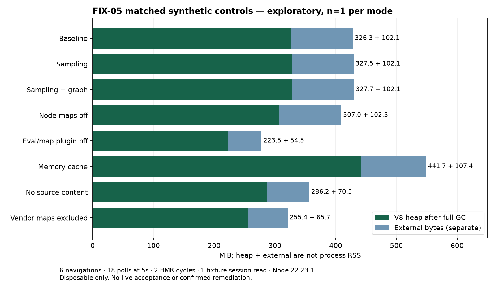

# FIX-05 sanitized diagnostic evidence

**SYNTHETIC DISPOSABLE ONLY — NOT LIVE ACCEPTANCE.** Raw heap snapshots, profiles,
private-detail paths, journals and fixture copies remain private. No real QA
records, sessions, credentials or source-system samples were used.

- [Retainer graph measurements](retainers.json): 12-navigation uninstrumented
  snapshot; strong-edge projection, not full WeakMap ephemeron semantics.
- [Matched full-GC comparisons](comparison.json): final 6/18/2/1 cohort, n=1/mode,
  effective compiler/Node settings, source fingerprints and fail-stop outcomes.
- [Emitted map shapes](artifact-shapes.json): counts only, no source content.
- [Heap/RSS/external timelines](timelines.csv): metrics, not allocation stacks.
- [Private snapshot inventory](private-evidence-inventory.json): hashes, sizes,
  capture overhead and protocol identity; no raw payloads.
- [Comparison figure](comparison.png): heap and external are separate metrics,
  not interchangeable with RSS/cgroup memory.
- [Report and interpretation](../../nadi-dev-status-runtime-fix-05.md).

Earlier snapshot refusals, a resource-stopped calibration and abandoned Inspector
GC checkpoint are recorded in the report. They are not pooled with successful
matched controls. Generic source reachability is not proof of exclusive ownership.
CI does not establish sustained preview stability.
